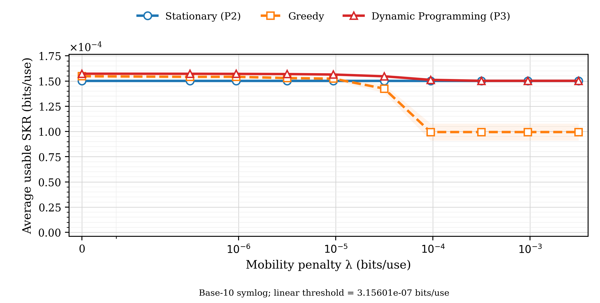
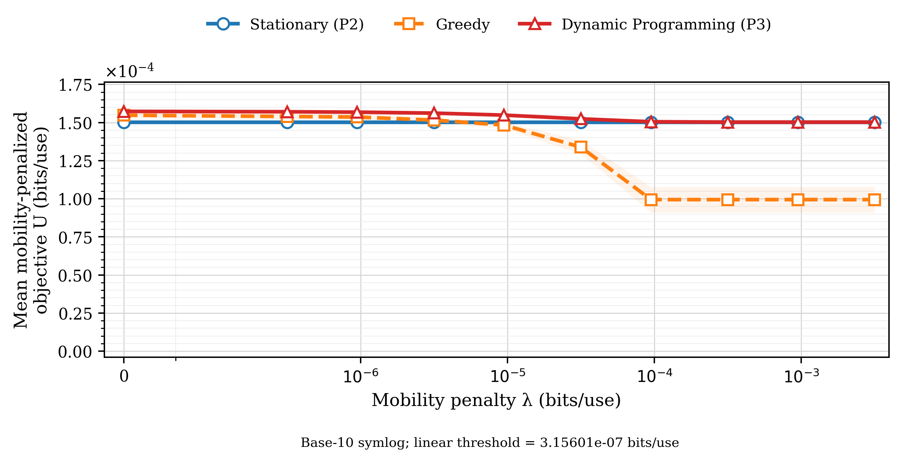
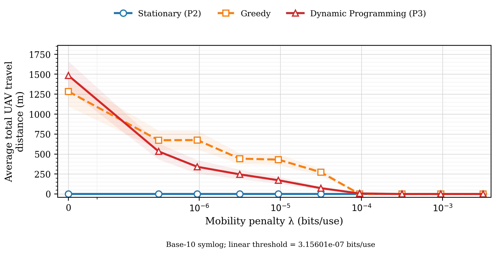
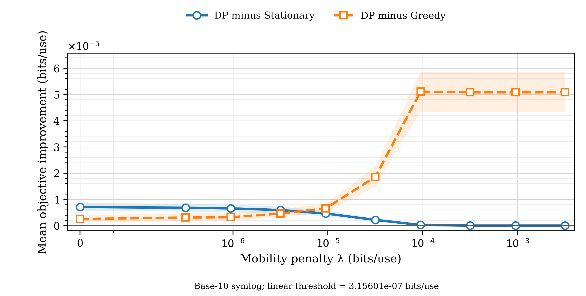
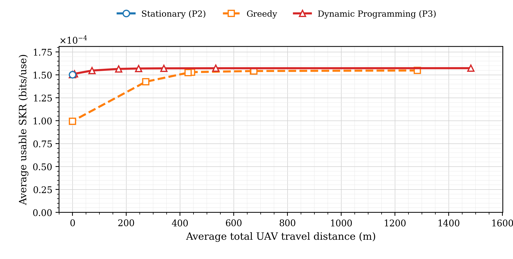
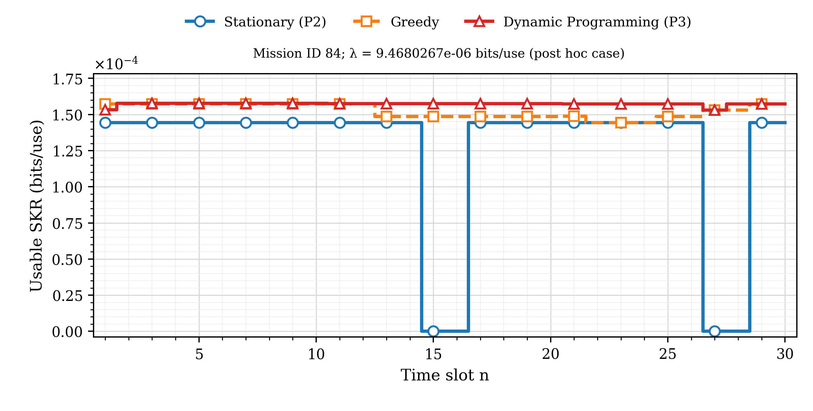
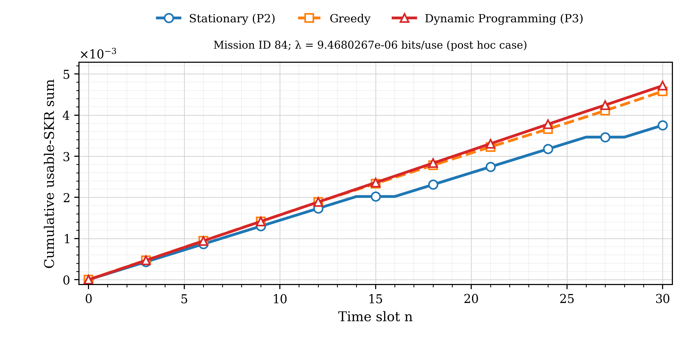
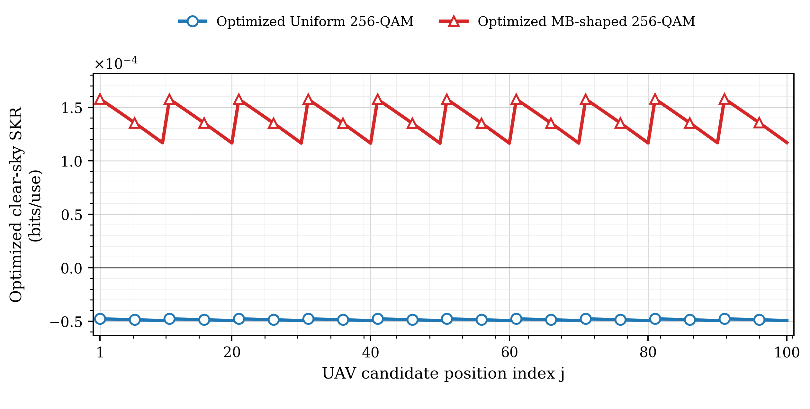

# Diễn giải tám hình so sánh

UNVALIDATED_SECURITY_MODEL — NOT_READY_FOR_PUBLICATION_SCALE_RUNS

Không có lượt chạy mới của vật lý, SKR, nguồn, mây hoặc P1/P2/P3/Greedy. Tất cả metric được đối chiếu trực tiếp từ đường và S đã lưu. Yêu cầu ghi λ=9.46803e-06; số làm tròn đó không có chính xác trong schedule. Dùng giá trị đại diện đã chốt λ=9.468026677248516e-06 bits/use, không thêm điểm λ mới. Kiểm kê đầy đủ: [data_inventory.md](data_inventory.md).

## Hình1 — SKR trung bình

Ở λ đại diện: P2=0.000150242818661, Greedy=0.000152387911764, DP=0.000156495352662 bits/use. DP tăng 4.16161921% và 2.69538499% so với hai baseline. Đây là tỷ lệ của các mean trên cùng100 mission, không mean của phần trăm cá thể. Đường P2 không đổi theo λ. DP mean K cao hơn hoặc bằng hai mean baseline trong tập10λ này; không suy ra điều đó cho từng mission khi λ>0. Trục y bắt đầu0 nên chênh vài phần trăm ở vùng trên khá nhỏ; hình4 cho effect-size objective rõ hơn.

## Hình2 — Objective tối ưu

Không có vi phạm U_DP≥U_P2,U_Greedy vượt1e−12 trong1000 cặp mission–λ. Ở λ đại diện, gain meanU lần lượt 3.07497816% và 4.41765926%. Điều này hỗ trợ hiệu quả của DP trong bài toán lưới/horizon đã cho, không phải bảo đảm bảo mật hoặc điều khiển causal. Các strategy có cùng miền điểm đầu tự do; chúng không nhất thiết có cùng tọa độ đầu hay lượng thông tin.

## Hình3 — Quãng đường

P2 luôn0m. MeanD DP giảm từ1482,687833973m tại λ=0 xuống0 tại0,1λhi; ở0,03λhi vẫn có7 mission di chuyển. Greedy có31 lần tăngD giữa λ kề nhau trên25 mission. MeanD Greedy tăng673,874746570→675,150250806m giữa0,0001 và0,0003λhi; mức1,2755m nhỏ trên trục0–khoảng1700m, không nên phóng đại bằng mắt. Không ép đường đơn điệu. Tại λ=0 DP đi nhiều hơn Greedy ở trung bình; tại λ đại diện DP đi ít hơn. Greedy dừng hoàn toàn từ0,03λhi nhưng dừng ở điểm được chọn theo slot đầu, không tự trở thành P2.

## Hình4 — Gain objective theo cặp

Ở λ đại diện: DP thắng P2 trong61/100 mission, thắng Greedy trong89/100; còn lại hòa trong1e−12. Bootstrap CI95% meanΔU/P2=[3.5773230096e-06,5.73650487882e-06], meanΔU/Greedy=[4.99920107133e-06,8.46048158974e-06] bits/use. Cả hai dương tại điểm này nhưng CI là pointwise, chưa hiệu chỉnh nhiều so sánh. Ở λ lớn DP hòa P2 nên không có gain mobility dương để tuyên bố. Gain DP−Greedy lớn ở λ cao phần lớn phản ánh chọn điểm đứng yên offline tốt hơn lựa chọn slot-đầu của Greedy, không phải DP đang bay nhiều.

## Hình5 — K và quãng đường

Các điểm nối theo λ tăng, giữ cả các đoạn quay lại do Greedy không đơn điệu. λ=0,0001λhi của DP giữ99,953824% meanK tạiλ0 trong khi giảm64,026687% meanD. Tại0,003λhi, DP dùng172,432989779m so với430,610183254m của Greedy và có meanK cao hơn. Các điểm này mô tả chính sách/λ đã thử, không phải Pareto frontier vật lý toàn cục hoặc năng lượng. Không có λ tối ưu phổ quát khi chưa hiệu chuẩn chi phí bay và ưu tiên kỹ thuật.

## Hình6 — Theo slot, mission84

Chọn hậu nghiệm bằng tiêu chí đã ghi trong caption, không thay mission0 của báo cáo gốc. P2 bị chặn4slot; Greedy và DP không bị chặn dọc đường đã chọn. DP đi847,2135955m/5 lần đổi vị trí, Greedy1088,6349517m/7 lần. DP có thể chấp nhận utility tức thời thấp để tránh blockage về sau; chẳng hạn slot2:81→80 khi cả hai điểm đang clear, trong khi điểm81 bị chặn21slot còn lại. Đây là ví dụ giải thích có chọn theo kết quả, không phải một mẫu đại diện ngẫu nhiên cho gain trung bình.

## Hình7 — Cộng dồn

Ba đường lấy cumulative sum đúng theo cùng mission/λ của hình6; cuối đường bằng30 lần meanK của method. Đường riêng lẻ không giảm. DP có thể thấp hơn Greedy ở prefix đầu; không yêu cầu thứ tự giữa các đường tại mọi slot. Không gọi ordinate là tổng bit khóa: chưa có pulse rate, channel uses hoặc overhead khi di chuyển/reacquisition.

## Hình8 — P1 raw Uniform và MB

Uniform tối ưu có raw K âm ở100/100 điểm; MB raw K dương, cùng(ν,VA)=(0,125;8) tại100điểm. Giữ nguyên raw âm trên trục tuyến tính và vạch0; không tính phần trăm shaping gain trên Uniform âm/usable0. VA8 là biên catalog; hai family tối ưu VA riêng nên không cô lập PMF ở cùng năng lượng. Các răng cưa do thứ tự index x-first: chuyển từ cuối một hàng sang đầu hàng kế, không phải đường bay hoặc đường liên tục theo khoảng cách.

## Bốn hình ưu tiên cho manuscript

**2,4,5,8**: hình2 kiểm trực tiếp mục tiêu P3 với3 phương án; hình4 hiển thị độ lớn chênh theo cặp và uncertainty mà đường tuyệt đối có thể che; hình5 cho tradeoff K–D; hình8 cho kết quả nguồn P1 và raw âm Uniform. Hình1/3 bổ sung giải thích theoλ nhưng một phần trùng thông tin hình5; hình6/7 hợp appendix hoặc đoạn giải thích cơ chế vì chỉ là một ví dụ hậu nghiệm. Cả8 hình không có phương án Fixed44 nên không tự chứng minh gain P2 so với không chọn vị trí. Muốn nêu gain85,46% đó phải dẫn bảng P2/reference trong analysis trước, giữ rõ baseline44 được tái dựng hậu phân tích.

## Giới hạn

100 mission độc lập theo các streamSeedSequence khác nhau, nhưng ô/slot trong một mission tương quan; CI dùng đơn vị mission. P2/DP biết toàn bộ mây, Greedy biết current-slot oracle; không có cùng-information ablation. Hình học/mây tổng hợp, complete blockage, finitecatalog/grid, bỏ qua transit/reacquisition, distance chưa là joule. Không nâng lifecycle, không thêm test/held-out, không sửa detector/evaluator/frozen/cache/manuscript ngoài repo. Các cảnh báo bảo mật vẫn giữ nguyên.
