# Phân tích định lượng P1–P2–P3 và lợi ích mobility

**UNVALIDATED_SECURITY_MODEL — NOT_READY_FOR_PUBLICATION_SCALE_RUNS**

Đây là hậu phân tích các kết quả số đã hoàn tất. Không chạy lại P1/P2/P3/Greedy, kênh, SKR, C,w hoặc sinh mây. Các bảng và hình bổ sung nằm riêng trong `analysis/`; mọi artifact mô phỏng gốc được kiểm tra SHA-256 trước và sau phân tích. Bản thảo tiếng Anh ở [numerical_results_discussion_en.md](numerical_results_discussion_en.md) là bản nháp để tác giả xem xét, chưa sửa manuscript bên ngoài repo.

## 1. Phạm vi, phép đo và truy vết

Nguồn: `../p1/candidate_evaluations.csv`, `../p1/winners.csv`, `../mobility/mission_metrics.csv`, `../mobility/paths.npz`, `../clouds/states.npz`, `../positions.csv`, `../protocol.json` và các receipt. Tái dựng trực tiếp SKR, quãng đường và objective của cả 3.000 đường đã lưu, đồng thời đối chiếu các trung bình, SD và CI t với bảng gốc. 23.300 hàng vị trí–nguồn gồm đủ 233 ensemble ở mỗi vị trí; không xếp hạng bằng nguồn hay evaluator mới.

Hệ thống giữ nguyên: 100 tâm ô trong 1 km × 1 km, HAP cao 20 km, UAV cao 1 km, 30 slot × 20 s, vmax=15 m/s, mỗi bước ≤300 m, Dref=1.000 m. Điểm đầu tự chọn cho mọi chiến lược; không tính triển khai hoặc quay về. Cùng giả định khởi tạo không có nghĩa là ép cùng tọa độ đầu: P2/DP dùng toàn bộ nhiệm vụ, Greedy dùng slot đầu rồi các slot hiện tại.

Nguồn 197 MB + 36 Uniform. Quang học 1550 nm, phân kỳ toàn phần 233 µrad, đường kính thu 0,08 m; β=0,95 và ξch=0,0186. Giữ chuẩn VA=2⟨n⟩, MI 2D với phương sai mỗi trục 1+N và Holevo homodyne theo protocol của lượt chạy. Không thay quy ước này bằng functional production khác.

Các metric được giữ riêng: $K_j^*=[\max_g K_{j,g}^{raw}]^+$; $S_{j,n}=(1-c_{j,n})K_j^*$; $\overline K=\sum_n S_{j_n,n}/30$; $D=\sum_{n=2}^{30}d_{j_{n-1},j_n}$; $U=\overline K-\lambda D/1000$. Availability là tỷ lệ slot có S>0. Đơn vị rate là bits/use, không phải bits/s hay tổng số bit.

Dải λ giữ nguyên 10 hệ số [0, 0.0001, 0.0003, 0.001, 0.003, 0.01, 0.03, 0.1, 0.3, 1], λhi=0.003156008892 bits/use. Điểm phân tích chính dùng λ=9.468026677e-06 (=0,003 λhi), đã chốt trước khi xem quỹ đạo.

## 2. P1: tối ưu nguồn hữu hạn

|Đại lượng trên 100 vị trí|Min|Max|Mean|SD toàn bộ lưới (ddof=0)|
|---|---|---|---|---|
|MB tối ưu, bits/use|0.0001162962774|0.0001578004446|0.0001372424595|1.308760671e-05|
|Uniform tối ưu raw, bits/use|-4.939790576e-05|-4.774833925e-05|-4.858540304e-05|5.206229678e-07|
|Khoảng cách (km)|21.6936322|22.14766483|21.91770717|0.14310974|
|Góc zenith (độ)|28.85627968|30.92081858|29.89136314|0.650810855|
|MB thứ nhất − thứ hai (bits/use)|4.332961206e-07|4.50184782e-07|4.417806788e-07|5.324065504e-09|
|Chênh thứ nhất − thứ hai / thứ nhất (%)|0.2745848541|0.3871016269|0.3252592373|0.03537064878|

Cả 100/100 vị trí chọn (ν,VA)=(0,125;8). Nguồn đứng thứ hai tại tất cả vị trí là (0,15;8). Chênh tuyệt đối 4.332961206e-07–4.50184782e-07 bits/use, tức 0.2745848541–0.3871016269%. Hai lựa chọn gần nhau về hiệu năng, nhưng không phải hòa về số học.

VA=8 là trần catalog MB (max=8). Không có bằng chứng rằng đạo hàm theo VA đổi dấu hoặc nguồn tốt hơn không tồn tại ở VA>8. Vì vậy chỉ kết luận **best exact-tested trong catalog hữu hạn**, không tối ưu liên tục/toàn cục. 100 vị trí không phải 100 mẫu kênh độc lập: lưới có 60 danh tính hình học chính xác, các vị trí đối xứng dùng chung moment. SD không gian là mô tả lưới; không lập CI suy diễn từ 100 ô.

Tính ổn định đã quan sát được giới hạn ở L=21.6936322–22.14766483 km và zenith=28.85627968–30.92081858 độ. Nguồn thắng không đổi trong miền này. Khoảng cách xếp hạng nhỏ nhất lớn hơn khoảng 1140252.949 lần tổng hai allowance MI (2β×2e−13). Đây là đối chiếu với allowance quadrature, không phải bound tổng sai số của mô hình hay nguồn. Không có dữ liệu perturbation riêng của jitter, Cn², ξch hoặc các tham số quang khác; không kết luận robustness theo các tham số đó. Kế hoạch tối thiểu nếu được yêu cầu thêm là lưu protocol perturbation và chỉ đánh giá hai nguồn đầu trên các trạng thái mới đã duyệt; nhiệm vụ này không thực hiện các phép tính ấy.

Uniform có raw SKR âm ở 100/100 vị trí: -4.939790576e-05 đến -4.774833925e-05 bits/use. Kiểm tra dựa trên raw candidate và raw family maximum, không dựa trên số 0 sau clipping. MB tạo usable lift tuyệt đối 0.0001162962774–0.0001578004446 bits/use, trung bình 0.0001372424595 so với Uniform usable=0. **Không tính phần trăm tăng so với 0.**

So sánh hai family được tối ưu VA riêng chưa cô lập hiệu ứng PMF: MB chọn VA=8 còn Uniform có miền VA khác. Bổ sung đối chiếu cùng VA=8 từ candidate đã lưu: Uniform raw mean=-0.0004565551269; raw MB−Uniform mean=0.0005937975863 bits/use. Cả hai có cùng năng lượng trung bình VA/2=4 photon theo chuẩn nguồn. Đối chiếu này hỗ trợ khác biệt modulation ở cùng năng lượng trung bình trong mô hình đang dùng; không đảm bảo cùng peak amplitude, phần cứng hoặc bảo mật thực nghiệm.

P1 không đổi nguồn theo vị trí trong lượt này. Do đó không thể gán gain P2/P3 cho một policy đổi nguồn động: tất cả phương án mobility dùng cùng nguồn MB đã chọn. Bảng chi tiết: [p1_position_details.csv](tables/p1_position_details.csv).

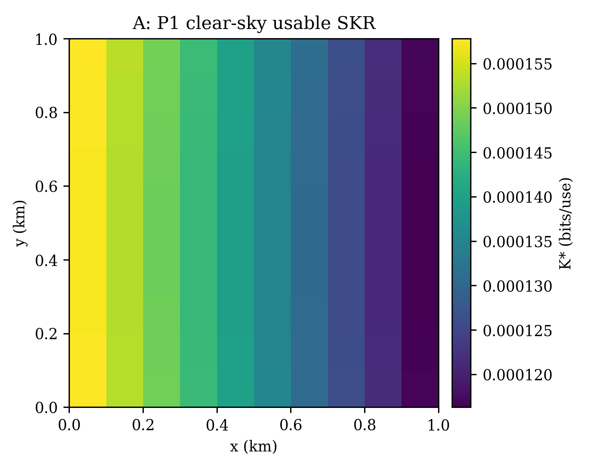

## 3. P2: giá trị của chọn vị trí đứng yên

Protocol có `reference_position_index=44`, tọa độ (450,450) m, từ trước lượt mô phỏng. Lượt chạy gốc chưa có một phương án metric tên FixedReference; điểm này vốn dùng kiểm tra hình học. Ở đây baseline cố định được **tái dựng hậu phân tích tại đúng điểm tham chiếu đã có**, bằng mean(S[rid,44,:]); không đề xuất tọa độ mới, không chọn lại vị trí theo kết quả và không chạy kênh. Đây chưa phải baseline vận hành đã preregister riêng.

|Phương án|Mean K|SD mẫu K|Median|P05|P95|CI95% mean, t|
|---|---|---|---|---|---|---|
|Fixed tại index44|8.101245823e-05|3.4915412e-05|8.370977314e-05|1.371910171e-05|0.0001395162886|[7.408448299e-05, 8.794043347e-05]|
|P2|0.0001502428187|8.183107362e-06|0.0001529571714|0.0001362881171|0.0001578004446|[0.0001486191126, 0.0001518665247]|
|P2 − Fixed, paired|6.923036043e-05|3.42857441e-05|6.470434793e-05|1.761301645e-05|0.0001384380576|[6.242732497e-05, 7.60333959e-05]|

P2 tăng mean K 85.45643712% theo tỷ số hai trung bình. Availability trung bình tăng từ 58.06666667% lên 97.76666667%. P2 chọn 34 vị trí khác nhau; 67/100 nhiệm vụ có đủ 30 slot thông thoáng tại điểm được chọn. 2/100 nhiệm vụ có hơn một vị trí trong 1e−12 bits/use so với cực đại; tần suất vị trí chịu ảnh hưởng tie-break trong các trường hợp đó.

|Index0 / j bản thảo|x (m)|y (m)|Số nhiệm vụ|Tỷ lệ|
|---|---|---|---|---|
|40 / 41|50|450|8|8%|
|90 / 91|50|950|8|8%|
|10 / 11|50|150|7|7%|
|20 / 21|50|250|7|7%|
|50 / 51|50|550|7|7%|
|0 / 1|50|50|5|5%|
|80 / 81|50|850|5|5%|
|1 / 2|150|50|4|4%|
|21 / 22|150|250|4|4%|
|51 / 52|150|550|4|4%|

Vị trí clear-sky tốt nhất là index90, nhưng P2 chỉ chọn nó trong 8/100 nhiệm vụ. 72/100 lần P2 chọn một điểm có cloud-free fraction cao nhất; các lần còn lại đánh đổi một phần availability để có clear-sky K cao hơn. P2 tối ưu tích A_jK_j, không tối ưu riêng từng yếu tố.

Để tách hai yếu tố đối với điểm tham chiếu, dùng phân rã đối xứng đại số (không diễn giải nhân quả):
$\Delta K=\tfrac12(A_*+A_r)(K_*-K_r)+\tfrac12(K_*+K_r)(A_*-A_r)$.

Thành phần clear-sky trung bình=1.10529594e-05; thành phần availability=5.817740103e-05 bits/use (84.03451993% tổng gain). Theo phân rã này, tránh mây đóng góp phần lớn; lợi thế clear-sky vẫn đáng kể. Đây là kết quả theo scenario p=0,4, ell=250 m, rho tiềm ẩn=0,9 đã cho, không phải sensitivity sweep theo tham số mây.

Bảng đủ 100 nhiệm vụ chứa tọa độ, clear fraction, clear K, mean K, slot chặn/dương và baseline ở [p2_stationary_missions.csv](tables/p2_stationary_missions.csv). P2 được chọn offline sau khi biết toàn bộ mây; gain 85,46% không thể chuyển nguyên vẹn thành bảo đảm cho một UAV phải chọn vị trí trước nhiệm vụ.

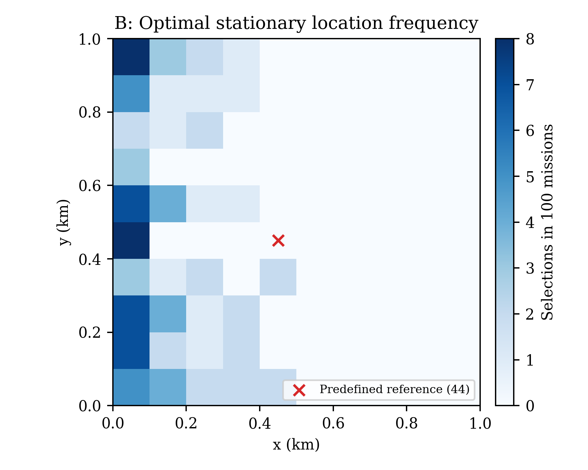

## 4. P3, Greedy và Stationary trên cùng nhiệm vụ

Bảng chính tại λ=9.468026677e-06. SD là SD mẫu giữa 100 nhiệm vụ độc lập.

|Phương án|Mean K|SD K|Mean D (m)|SD D (m)|Mean U|SD U|Availability|Số đổi vị trí|
|---|---|---|---|---|---|---|---|---|
|Stationary|0.0001502428187|8.183107362e-06|0|0|0.0001502428187|8.183107362e-06|0.9776666667|0|
|Greedy|0.0001523879118|8.746830746e-06|430.6101833|338.390001|0.0001483108831|1.05080599e-05|0.9873333333|3.21|
|DP|0.0001564953527|1.950793832e-06|172.4329898|215.3049948|0.0001548627525|3.428048983e-06|0.999|1.12|

|Phương án / metric|Median|P05|P95|
|---|---|---|---|
|Stationary / K|0.0001529571714|0.0001362881171|0.0001578004446|
|Stationary / D|0|0|0|
|Stationary / U|0.0001529571714|0.0001362881171|0.0001578004446|
|Greedy / K|0.0001552486173|0.0001395055549|0.0001578004446|
|Greedy / D|370.7106781|0|1186.09412|
|Greedy / U|0.0001508889224|0.0001269658367|0.0001578004446|
|DP / K|0.0001573368485|0.0001516141766|0.0001578004446|
|DP / D|100|0|600.3224755|
|DP / U|0.0001559122337|0.0001480759889|0.0001578004446|

DP tăng mean K so với P2 6.252534001e-06 bits/use (4.161619209%), so với Greedy 4.107440898e-06 (2.695384988%). Mean ΔU tương ứng 4.619933854e-06 (3.074978155%) và 6.551869453e-06 (4.417659256%). Quãng đường DP trung bình 172.4329898 m, nhỏ hơn Greedy 430.6101833 m.

Đối với U, DP thắng nghiêm ngặt P2 trong 61/100 nhiệm vụ, hòa 39; thắng Greedy trong 89, hòa 11; không có vi phạm dominance vượt 1e−12. Đối với K chưa phạt, DP thấp hơn Greedy trong 25/100 nhiệm vụ, cao hơn trong 64, hòa 11. Đây là đánh đổi đúng mục tiêu, không phải lỗi DP.

DP và P2 biết cùng horizon 30 slot; Greedy biết trạng thái tất cả 100 vị trí ở slot hiện tại, không được thấy tương lai. Cả ba dùng cùng masks, cùng P1, cùng miền điểm đầu tự do và cùng giới hạn vận tốc. Đây là so sánh benchmark offline với một heuristic causal; không phải so sánh hai controller có cùng lượng thông tin hoặc cùng điểm đầu thực tế. Không có ablation cùng điểm đầu/cùng lookahead để gán một tỷ lệ nhân quả riêng cho thông tin tương lai.

## 5. Toàn bộ dải λ và tính đơn điệu

|λ (bits/use)|Method|Mean K|SD K|Mean D (m)|Mean U|Availability|
|---|---|---|---|---|---|---|
|0|Stationary|0.0001502428187|8.183107362e-06|0|0.0001502428187|0.9776666667|
|0|Greedy|0.0001547905515|7.348099407e-06|1283.330591|0.0001547905515|0.9856666667|
|0|DP|0.0001573051191|9.447751575e-07|1482.687834|0.0001573051191|1|
|3.156008892e-07|Stationary|0.0001502428187|8.183107362e-06|0|0.0001502428187|0.9776666667|
|3.156008892e-07|Greedy|0.0001542005857|8.225932316e-06|673.8747466|0.0001539879103|0.982|
|3.156008892e-07|DP|0.0001572324819|9.486769029e-07|533.3719312|0.0001570641492|1|
|9.468026677e-07|Stationary|0.0001502428187|8.183107362e-06|0|0.0001502428187|0.9776666667|
|9.468026677e-07|Greedy|0.0001542431399|8.089208043e-06|675.1502508|0.0001536039058|0.9833333333|
|9.468026677e-07|DP|0.0001571238426|9.890044657e-07|340.6637272|0.0001568013013|1|
|3.156008892e-06|Stationary|0.0001502428187|8.183107362e-06|0|0.0001502428187|0.9776666667|
|3.156008892e-06|Greedy|0.0001529765529|8.642397934e-06|443.1774938|0.0001515778808|0.987|
|3.156008892e-06|DP|0.000156946341|1.333389186e-06|246.098611|0.0001561696516|0.9993333333|
|9.468026677e-06|Stationary|0.0001502428187|8.183107362e-06|0|0.0001502428187|0.9776666667|
|9.468026677e-06|Greedy|0.0001523879118|8.746830746e-06|430.6101833|0.0001483108831|0.9873333333|
|9.468026677e-06|DP|0.0001564953527|1.950793832e-06|172.4329898|0.0001548627525|0.999|
|3.156008892e-05|Stationary|0.0001502428187|8.183107362e-06|0|0.0001502428187|0.9776666667|
|3.156008892e-05|Greedy|0.0001424822429|2.049526583e-05|272.8111832|0.0001338722977|0.9143333333|
|3.156008892e-05|DP|0.0001547253088|4.306284883e-06|73.15747535|0.0001524164524|0.9946666667|
|9.468026677e-05|Stationary|0.0001502428187|8.183107362e-06|0|0.0001502428187|0.9776666667|
|9.468026677e-05|Greedy|9.944699224e-05|4.238640219e-05|0|9.944699224e-05|0.6313333333|
|9.468026677e-05|DP|0.000151200741|7.601394347e-06|7.414213562|0.0001504987613|0.982|
|0.0003156008892|Stationary|0.0001502428187|8.183107362e-06|0|0.0001502428187|0.9776666667|
|0.0003156008892|Greedy|9.944699224e-05|4.238640219e-05|0|9.944699224e-05|0.6313333333|
|0.0003156008892|DP|0.0001502428187|8.183107362e-06|0|0.0001502428187|0.9776666667|
|0.0009468026677|Stationary|0.0001502428187|8.183107362e-06|0|0.0001502428187|0.9776666667|
|0.0009468026677|Greedy|9.944699224e-05|4.238640219e-05|0|9.944699224e-05|0.6313333333|
|0.0009468026677|DP|0.0001502428187|8.183107362e-06|0|0.0001502428187|0.9776666667|
|0.003156008892|Stationary|0.0001502428187|8.183107362e-06|0|0.0001502428187|0.9776666667|
|0.003156008892|Greedy|9.944699224e-05|4.238640219e-05|0|9.944699224e-05|0.6313333333|
|0.003156008892|DP|0.0001502428187|8.183107362e-06|0|0.0001502428187|0.9776666667|

SD D, SD U, số đổi vị trí, min/max, median và P05/P95 của K/D/U đều có cho đủ 30 tổ hợp trong [method_comparison.csv](tables/method_comparison.csv), không chỉ cho điểm minh họa.

Quãng đường DP không tăng khi λ tăng trong từng nhiệm vụ. Với hai nghiệm tối ưu a,b và λb>λa, hai bất đẳng thức tối ưu cho (λb−λa)(Db−Da)≤0. Vì vậy xu thế này là thuộc tính bài toán có cùng S/miền khả thi; không ép hình thành đơn điệu. K tối ưu chưa phạt cũng không tăng theo λ≥0; giá trị tối ưu U là max của các hàm affine giảm theo λ.

DP trở thành đứng yên ở toàn bộ 100 nhiệm vụ từ λ=0.0003156008892 (=0,1 λhi); ở λ=9.468026677e-05 vẫn có 7 nhiệm vụ dịch chuyển. Chỉ có bracket giữa hai giá trị đã thử cho ngưỡng hết dịch chuyển của toàn bộ tập, không có ngưỡng chính xác trong miền λ liên tục. Greedy đã đứng yên hoàn toàn từ λ=9.468026677e-05, nhưng dừng tại điểm tốt nhất slot đầu, nên mean K chỉ 9.944699224e-05; không hội tụ về P2 chỉ vì D=0. Sau các mốc này, metric tương ứng không đổi khi tăng λ thêm trong các điểm đã lưu.

Greedy có 31 lần tăng D giữa hai λ kề nhau, thuộc 25 nhiệm vụ. Ở trung bình tập, D tăng từ 673.8747466 lên 675.1502508 m giữa 0,0001 và 0,0003 λhi; K cũng tăng từ 0.0001542005857 lên 0.0001542431399. Mỗi cặp dùng đúng cùng 100 masks, nên không phải do lấy mẫu lại mây. Kiểm tra lần phân kỳ đầu cho thấy điểm được chọn chuyển theo giao điểm score hữu hạn trên lưới: bước đầu có thể ngắn hơn khi λ lớn hơn nhưng dẫn đến các bước sau dài hơn. Không cần giả thuyết tie-break để giải thích các witness có score phân biệt; không khẳng định mọi trường hợp khác đều không có tie.

Bảng tradeoff DP so với λ=0:

|λ/λhi|Mean K|Mean D (m)|K giữ lại (%)|D giảm (%)|Số nhiệm vụ đứng yên|
|---|---|---|---|---|---|
|0|0.0001573051191|1482.687834|100|0|7|
|0.0001|0.0001572324819|533.3719312|99.953824|64.02668728|13|
|0.0003|0.0001571238426|340.6637272|99.88476124|77.02390757|28|
|0.001|0.000156946341|246.098611|99.77192219|83.40185942|38|
|0.003|0.0001564953527|172.4329898|99.48522562|88.37024316|39|
|0.01|0.0001547253088|73.15747535|98.35999598|95.0658882|54|
|0.03|0.000151200741|7.414213562|96.11940275|99.49994777|93|
|0.1|0.0001502428187|0|95.51044461|100|100|
|0.3|0.0001502428187|0|95.51044461|100|100|
|1|0.0001502428187|0|95.51044461|100|100|

Các điểm 0,0001–0,003 λhi cho phép giảm đáng kể quãng đường trong khi giữ gần toàn bộ mean K của λ=0; đây là tập lựa chọn để kỹ sư cân nhắc, không phải λ tốt nhất chung. Bảng `pareto_dp_summary.csv` còn ghi số nhiệm vụ có K hòa trong 1e−12 nhưng D giảm so với λ trước; ở những nhiệm vụ ấy chỉ có thay đổi đường/tie ở độ phân giải số đang xét. Những trường hợp K thay đổi thật là đánh đổi hữu hạn, không thể gán mọi mức giảm D tại λ nhỏ cho tie-breaking. Không có năng lượng đẩy hiệu chuẩn hoặc ưu tiên kỹ thuật để chọn một điểm phổ quát.

## 6. Phân tích thống kê theo cặp

Các realization dùng PCG64/SeedSequence([20261015,id]) riêng cho ID 0–99; mỗi nhiệm vụ có tương quan không gian và thời gian nội bộ. Mỗi nhiệm vụ là một cụm độc lập trong mô hình sinh đã lưu. CI t-Student cho mean dùng SD mẫu, 99 bậc tự do. Phân tích bổ sung dùng paired percentile bootstrap 20000 lần, seed 20261019: lấy mẫu lại toàn bộ mission với replacement, dùng cùng multiplicity mission cho mọi method/λ/metric. Không resample ô/slot như các mẫu độc lập. Đây là CI pointwise của mean chênh lệch, chưa hiệu chỉnh đồng thời 40 so sánh và không phải CI dự đoán nhiệm vụ riêng lẻ.

P05/P95 và percentile bootstrap dùng nội suy tuyến tính của NumPy. Hình F: hộp Q1–Q3, vạch median, whisker 1,5 IQR và các điểm ngoài whisker; whisker không đồng nghĩa P05/P95. Hình C giữ nguyên CI t95% của lượt chạy gốc; hình D dùng CI bootstrap theo cặp mới.

Hòa nếu |Δ|≤1e−12 bits/use; thắng nghiêm ngặt nếu Δ>1e−12. Lưu thêm số đếm Δ>0 theo float để tách sai khác cực nhỏ. Chỉ tính tỷ lệ khi mẫu số>1e−12; phần trăm trong bảng là chênh mean / mean baseline, khác mean của 100 phần trăm cá thể. Cả hai kiểu tỷ lệ và số mẫu số hợp lệ được lưu riêng.

|λ/λhi|Baseline|Mean ΔU|Bootstrap CI95%|Median ΔU|SD ΔU|Thắng / hòa / thua|Gain mean (%)|
|---|---|---|---|---|---|---|---|
|0|Stationary|7.062300454e-06|[5.629244619e-06, 8.581961816e-06]|4.76858779e-06|7.597769807e-06|93/7/0|4.700591028|
|0|Greedy|2.514567654e-06|[1.350046263e-06, 3.954755515e-06]|1.100740625e-07|6.804270557e-06|70/30/0|1.624496864|
|0.0001|Stationary|6.821330589e-06|[5.405598292e-06, 8.317269893e-06]|4.610740156e-06|7.495655566e-06|87/13/0|4.540204084|
|0.0001|Greedy|3.076238986e-06|[1.716372325e-06, 4.716934341e-06]|1.524163507e-07|7.833942866e-06|83/17/0|1.997714613|
|0.0003|Stationary|6.558482662e-06|[5.17996674e-06, 8.022240202e-06]|4.436237775e-06|7.306369177e-06|72/28/0|4.365255339|
|0.0003|Greedy|3.19739548e-06|[1.875247975e-06, 4.825273284e-06]|3.68645036e-07|7.70926888e-06|84/16/0|2.08158475|
|0.001|Stationary|5.926832974e-06|[4.658281036e-06, 7.270902687e-06]|4.034671329e-06|6.749912852e-06|62/38/0|3.944836118|
|0.001|Greedy|4.59177086e-06|[3.17922914e-06, 6.355102717e-06]|2.193395807e-06|8.207501899e-06|89/11/0|3.029314591|
|0.003|Stationary|4.619933854e-06|[3.57732301e-06, 5.736504879e-06]|3.027514869e-06|5.585102661e-06|61/39/0|3.074978155|
|0.003|Greedy|6.551869453e-06|[4.999201071e-06, 8.46048159e-06]|4.280323964e-06|8.949577424e-06|89/11/0|4.417659256|
|0.01|Stationary|2.173633753e-06|[1.491551983e-06, 2.925120352e-06]|0|3.696617653e-06|46/54/0|1.446747187|
|0.01|Greedy|1.854415467e-05|[1.487828998e-05, 2.248839289e-05]|1.178059468e-05|1.970210987e-05|88/12/0|13.8521225|
|0.03|Stationary|2.559426078e-07|[5.403068883e-08, 5.349534702e-07]|0|1.257908278e-06|7/93/0|0.1703526398|
|0.03|Greedy|5.105176903e-05|[4.350529816e-05, 5.867198441e-05]|4.757494939e-05|3.941669441e-05|89/11/0|51.33565921|
|0.1|Stationary|0|[0, 0]|0|0|0/100/0|0|
|0.1|Greedy|5.079582642e-05|[4.328766036e-05, 5.843341897e-05]|4.628273078e-05|3.944238962e-05|88/12/0|51.07829335|
|0.3|Stationary|0|[0, 0]|0|0|0/100/0|0|
|0.3|Greedy|5.079582642e-05|[4.328766036e-05, 5.843341897e-05]|4.628273078e-05|3.944238962e-05|88/12/0|51.07829335|
|1|Stationary|0|[0, 0]|0|0|0/100/0|0|
|1|Greedy|5.079582642e-05|[4.328766036e-05, 5.843341897e-05]|4.628273078e-05|3.944238962e-05|88/12/0|51.07829335|

Tại λ minh họa, cả ΔK và ΔU:

|Baseline|Metric|Mean Δ|Bootstrap CI95%|Mean phần trăm cá thể|Tỷ lệ hai mean (%)|
|---|---|---|---|---|---|
|Stationary|K|6.252534001e-06|[4.904357649e-06, 7.682022909e-06]|4.44570338|4.161619209|
|Stationary|U|4.619933854e-06|[3.57732301e-06, 5.736504879e-06]|3.289831987|3.074978155|
|Greedy|K|4.107440898e-06|[2.693434093e-06, 5.831199674e-06]|3.098006938|2.695384988|
|Greedy|U|6.551869453e-06|[4.999201071e-06, 8.46048159e-06]|5.003935984|4.417659256|

Bốn CI bootstrap tại λ minh họa đều có cận dưới dương, hỗ trợ gain trung bình trong tập scenario này. Không có nghĩa là mọi nhiệm vụ đều hưởng lợi: 39 lần DP hòa P2 về U, và 25 lần K của DP thấp hơn Greedy. CI và số lượng realization không xác thực bảo mật vật lý, không đại diện thời tiết đo, cũng không cung cấp kết quả held-out mới.

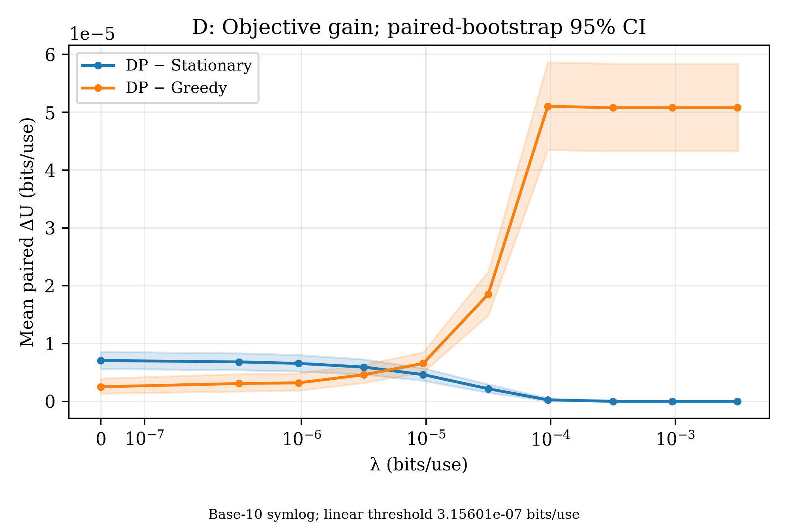

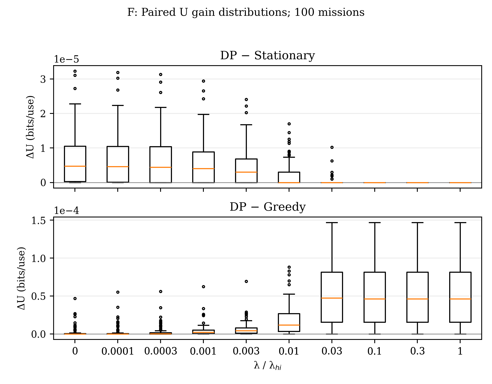

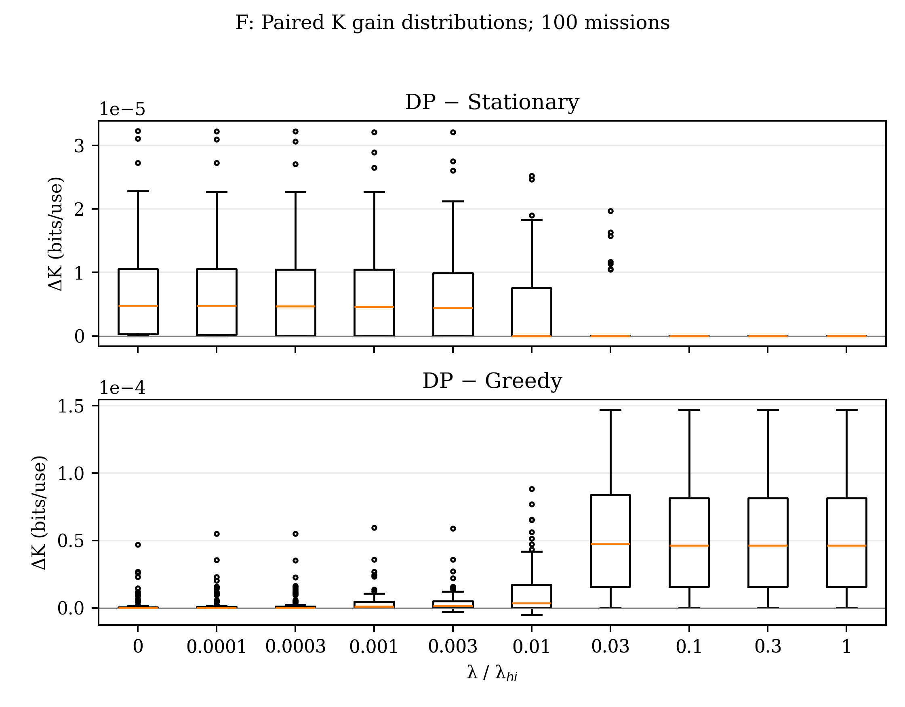

## 7. Các nhiệm vụ tiêu biểu và bằng chứng nhìn trước

Ba trường hợp dưới đây là chọn **hậu phân tích**, chỉ để giải thích cơ chế. Giữ nguyên λ=0,003 λhi; chọn ID nhỏ nhất khi hòa: (i) max ΔU(DP,P2); (ii) min |ΔU(DP,Greedy)| trong các nhiệm vụ DP có dịch chuyển và ΔU(DP,P2)>1e−12; (iii) ID đầu tiên có DP đứng yên và ΔU(DP,P2)≈0. Chúng không thay thế nhiệm vụ minh họa ID0 đã chốt trước trong báo cáo gốc; mọi kết luận về mean/CI vẫn dùng đủ 100 nhiệm vụ.

|Vai trò|ID|Method|Mean K|D (m)|U|Availability|Đổi vị trí|Đầu→cuối|
|---|---|---|---|---|---|---|---|---|
|large_DP_gain|84|Stationary|0.0001251111114|0|0.0001251111114|0.8666666667|0|83→83|
|large_DP_gain|84|Greedy|0.0001526083217|1088.634952|0.0001423010969|1|7|20→50|
|large_DP_gain|84|DP|0.0001571955759|847.2135955|0.000149174135|1|5|81→50|
|similar_Greedy_DP_moving|9|Stationary|0.0001523738731|0|0.0001523738731|0.9666666667|0|80→80|
|similar_Greedy_DP_moving|9|Greedy|0.0001574978457|200|0.0001556042404|1|1|80→60|
|similar_Greedy_DP_moving|9|DP|0.0001574978457|200|0.0001556042404|1|1|80→60|
|little_mobility_benefit|0|Stationary|0.0001576281446|0|0.0001576281446|1|0|80→80|
|little_mobility_benefit|0|Greedy|0.0001577257813|100|0.0001567789786|1|1|90→80|
|little_mobility_benefit|0|DP|0.0001576281446|0|0.0001576281446|1|0|80→80|

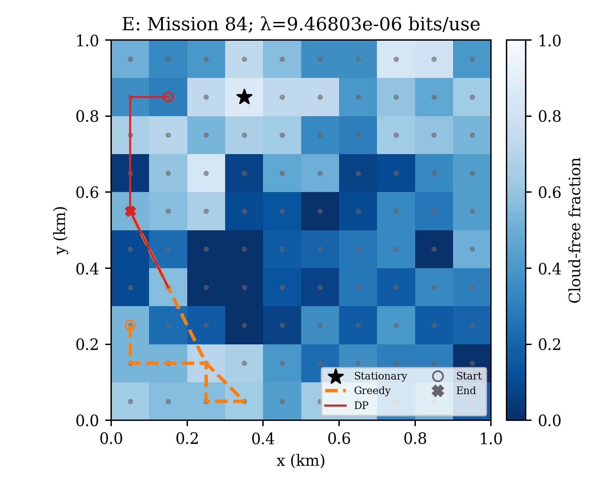

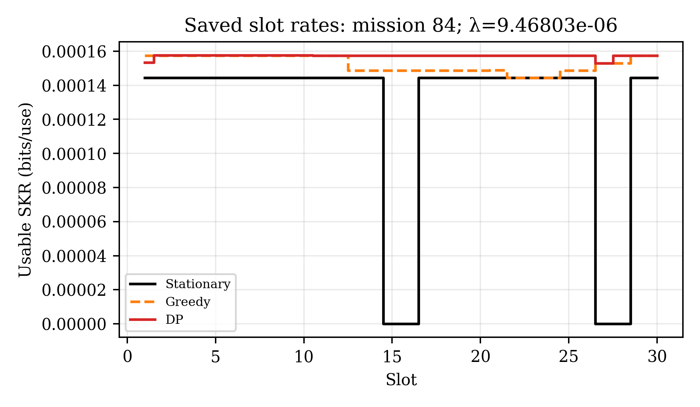

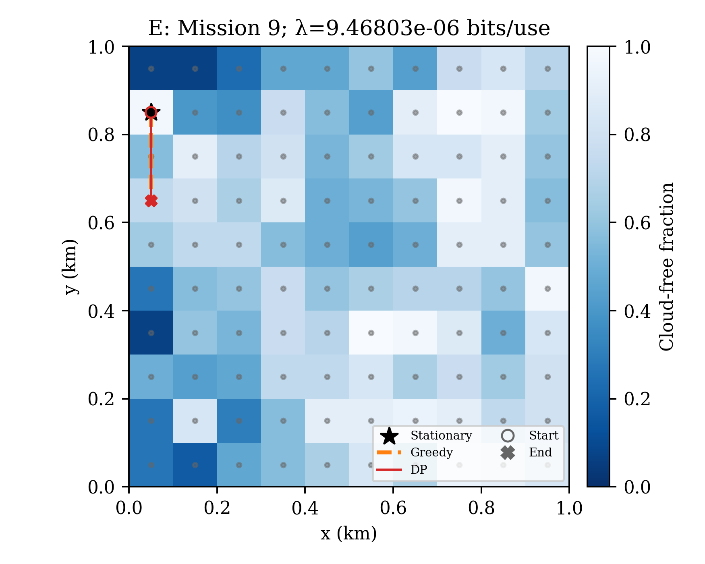

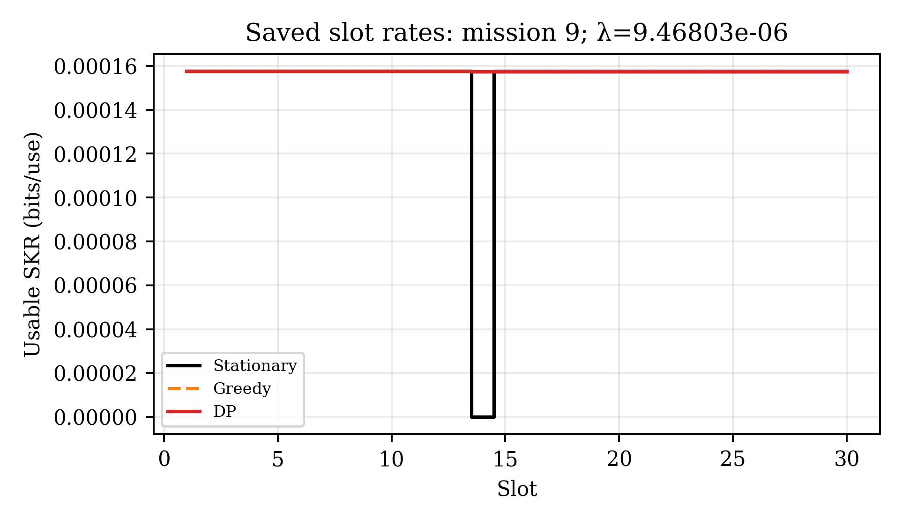

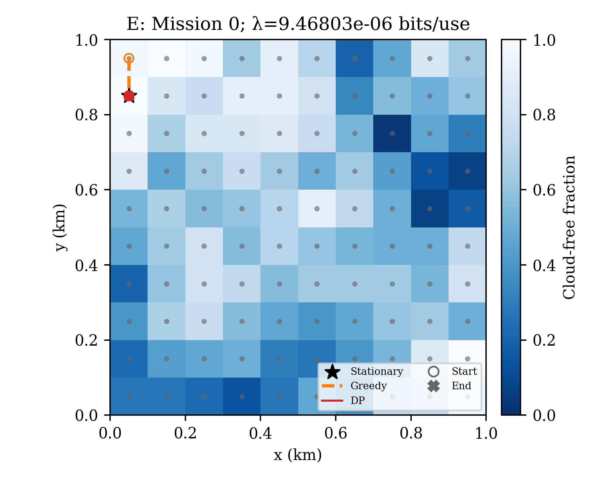

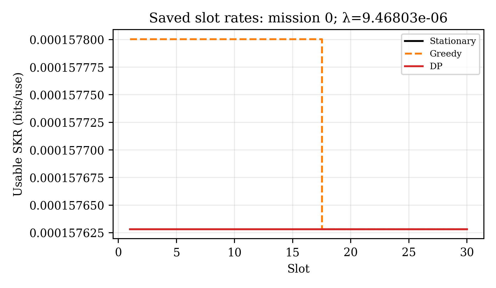

ID84 là trường hợp lợi ích objective DP lớn nhất so với P2 tại λ này. P2 ở index83, bị chặn 4 slot; Greedy và DP đều tránh toàn bộ slot chặn, nhưng DP đổi vị trí 5 lần thay vì 7 và đi 847,214 m thay vì 1.088,635 m. DP bắt đầu ở index81 thay vì điểm slot-đầu tốt nhất index20 của Greedy; lợi thế điểm đầu cũng sử dụng biết trước mây.

Với mỗi lần DP di chuyển từ i sang j ở slot n, đối chiếu utility tức thời với việc ở lại i: δu_n=(S[j,n]−S[i,n])/30−λd(i,j)/1000. Sau đó đối chiếu phần đường DP đã lưu từ n tới cuối với phương án khả thi đứng yên tại i từ n tới cuối. Phép đối chiếu chỉ đọc S và đường cũ, không giải một DP hay mô phỏng phản thực mới.

|ID|Slot|i→j|δu tức thời|Gain phần còn lại so với đứng yên i|Slot chặn tương lai nếu đứng i|
|---|---|---|---|---|---|
|84|2|81→80|-8.008721395e-07|0.0001031990664|21|
|84|28|31→50|-1.970998042e-06|8.518380888e-06|2|

Trong 100 nhiệm vụ tại λ minh họa, 52/112 lần dịch chuyển DP có δu tức thời âm, thuộc 38 nhiệm vụ. Đường tiếp tục có gain còn lại không âm so với đứng yên tại điểm trước trong mọi event được kiểm tra. Tại ID84 slot2, cả hai điểm đều thông thoáng nhưng DP di chuyển trước khi điểm cũ sẽ bị chặn 21 slot trong phần horizon còn lại. Đây là bằng chứng số trực tiếp cho quyết định nhìn trước; độ lớn gain phụ thuộc counterfactual đứng yên đã nêu, không phải tách nhân quả tuyệt đối của lookahead.

ID9 là trường hợp Greedy và DP cho cùng K, D=200 m, U và cùng đường 80→60 với một lần chuyển ở slot14, đúng lúc điểm80 bị chặn. Phản ứng một bước đủ cho cấu trúc mây của trường hợp này. ID0 không cần mobility theo U: P2/DP ở index80 thông thoáng cả 30 slot; Greedy bắt đầu index90 rồi chuyển100 m sang80, thu thêm một lượng K nhỏ nhưng không bù được phạt. Không dựng quỹ đạo minh họa đẹp hơn và không kết luận mobility luôn hữu ích.

## 8. Khi nào mobility có lợi?

Tạo upper bound từ chính S: Kslot=mean_n max_j S[j,n], không ràng buộc vận tốc. H=Kslot−K_P2 đo headroom thời gian–không gian còn lại sau chọn một vị trí. Đây là bound bằng dữ liệu đã lưu, không phải một thuật toán trajectory mới. Nếu H=0, không đường nào có K cao hơn P2; với λ≥0, dịch chuyển không thể tạo gain objective dương.

|Điều kiện tại λ minh họa|N|Mean ΔK DP−P2|Mean ΔU DP−P2|Tỷ lệ thắng U|Mean D DP (m)|
|---|---|---|---|---|---|
|P2_all_30_slots_clear|67|2.917210882e-06|2.043180039e-06|0.4179104478|92.31393964|
|P2_has_blocked_slots|33|1.302425064e-05|9.851524932e-06|1|335.0989401|
|oracle_headroom_zero|7|0|0|0|0|
|oracle_headroom_positive|93|6.72315484e-06|4.96767081e-06|0.6559139785|185.411817|

33 nhiệm vụ P2 còn ít nhất một slot chặn đều có gain U DP dương; mean ΔU của nhóm này lớn hơn nhóm P2 thông thoáng cả30 slot. Ngay khi P2 đã thông thoáng, một số đường vẫn có lợi nhỏ nhờ khai thác các vị trí clear-sky K cao hơn ở những thời điểm phù hợp. Bảy nhiệm vụ có H≈0 không có gain từ mobility. Mây đồng nhất theo vị trí hoặc điểm tốt đã thông suốt cả horizon làm giảm headroom; mây chặn phần lớn vùng cùng lúc không tạo được lợi thế chỉ nhờ dịch chuyển. Các phát biểu sau là cơ chế theo S, không phải kết quả của một sweep mây mới.

|Feature|Spearman ρ với ΔK|Spearman ρ với ΔU|
|---|---|---|
|global_blocked_fraction|0.3686458258|0.3418565931|
|spatial_clear_fraction_sd|0.1131688896|0.1259631856|
|entirely_clear_positions|-0.4153936569|-0.3877835107|
|p2_clear_fraction|-0.7210857871|-0.7026009782|
|oracle_headroom|0.9539197663|0.9399723406|

Các tương quan chỉ là exploratory trên100 scenario đã dùng. Headroom và ΔK cùng được dựng từ S nên tương quan mạnh một phần mang tính cấu trúc; không diễn giải là bằng chứng nhân quả độc lập hoặc predictor đã xác thực trên held-out.

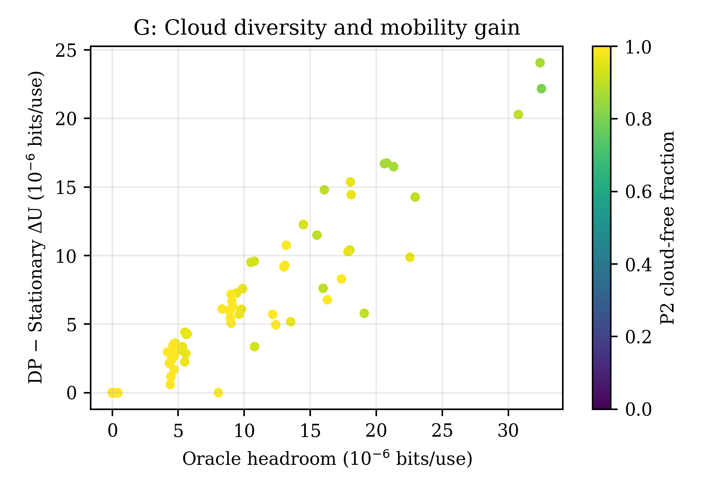

## 9. Giới hạn khoa học và gói kiểm chứng

1. Finite-grid DP là tối ưu điều kiện theo S và horizon đã cho; không tối ưu quỹ đạo liên tục hoặc vị trí giữa ô. Finite-source P1 có VA=8 ở trần; không continuous/global optimum.

2. P2/DP dùng toàn bộ cloud-state matrix offline. Greedy vẫn có oracle trạng thái hiện tại ở mọi vị trí; không mô hình hóa ước lượng/feedback, trễ, dự báo sai hoặc mây chưa quan sát.

3. Complete blockage, hình học và Gaussian-copula mây là tổng hợp. Không có sensitivity mới theo p, ell, rho hoặc dữ liệu thời tiết thực. Slot tương quan nội bộ không làm tăng số mẫu độc lập vượt100.

4. Thời gian bay và reacquisition không trừ khỏi usable slots; không tính outage dọc đoạn di chuyển, gia tốc, năng lượng, hoặc chi phí triển khai/đường về. Quãng đường chỉ là surrogate, λ không được hiệu chuẩn sang joule. Không suy ra bits/s, tổng bit hay bits/J khi chưa có channel-use rate.

5. MI 2D ghép Holevo homodyne là functional số theo manuscript, chưa là homodyne protocol security proof. Không có kết luận composable/finite-size, attack-class mới, parameter-estimation hoặc xác nhận bảo mật từ CI/tests. Giữ `UNVALIDATED_SECURITY_MODEL` và `NOT_READY_FOR_PUBLICATION_SCALE_RUNS`.

6. Hash frozen hiện tại df83ea63…db78c15 khác giá trị lịch sử 561fecc9…a7b1; giữ nguyên discrepancy, Objective C USER_STOPPED và mọi lifecycle blocker. Không sửa pipeline, cache, frozen spec, bản thảo ngoài repo, commit hoặc push.

Nguồn gốc: `startup_manifest.json`, `analysis_summary.json`, `computation_validation.json`, `analysis_receipt.json` (kiểm tra hậu xuất hình/report và hash toàn gói), cùng hai script producer. Receipt gốc được xác thực trực tiếp theo danh sách hash của nó; không chạy lại verifier gốc vốn quét đệ quy cả thư mục mới analysis/. 24 test/346 checks của lượt mô phỏng là evidence cũ được kiểm tra provenance, không tuyên bố đã chạy lại chúng trong nhiệm vụ phân tích này.

## 10. Trả lời định lượng tám câu hỏi cuối

1. **Nguồn P1:** MB (ν,VA)=(0,125;8), không đổi ở100/100 vị trí; nguồn thứ hai(0,15;8), gap 4.332961206e-07–4.50184782e-07 bits/use. Ổn định trong miền hình học đã khảo sát, chưa xác thực perturbation quang học khác; VA=8 là trần.

2. **P2 chọn đâu:** index40=(50,450)m và90=(50,950)m cùng8/100 lần; tiếp theo50,10,20 cùng7 lần. Tổng 34 vị trí khác nhau. P2 đạt mean K=0.0001502428187, cao hơn tham chiếu44 85.45643712%.

3. **Gain mean K DP:** tại λ=9.468026677e-06, so với P2 6.252534001e-06 bits/use (4.161619209%), so Greedy 4.107440898e-06 (2.695384988%). Tại λ=0, tăng 4.700591028% và 1.624496864%; không nội suy ra mọi λ.

4. **Gain objective DP:** λ minh họa: ΔU/P2=4.619933854e-06 (3.074978155%), ΔU/Greedy=6.551869453e-06 (4.417659256%). Thắng U lần lượt61 và89/100, còn lại hòa.

5. **Tăng λ:** meanD DP giảm 1482.687834→0 m; meanK giảm 0.0001573051191→0.0001502428187. 100/100 DP đứng yên từ λ=0.0003156008892. Greedy có31 transition tăngD trên25 nhiệm vụ và dừng sớm hơn nhưng không đạt vị trí P2.

6. **Điều kiện lợi nhất:** P2 vẫn có slot chặn nhưng các vị trí khả thi khác thông ở các thời điểm bổ sung. 33/33 nhiệm vụ như vậy có ΔU DP>0 tại λ minh họa; meanΔU=9,851524932e−6 bits/use so với2,043180039e−6 ở67 nhiệm vụ P2 thông hết. Đây là phân nhóm hậu nghiệm, không forecast ngoài dữ liệu.

7. **Robust qua nhiệm vụ:** bootstrap CI95% meanΔU/P2=[3.57732301e-06,5.736504879e-06], meanΔU/Greedy=[4.999201071e-06,8.46048159e-06] tại λ minh họa; cả hai dương nhưng không thắng mọi nhiệm vụ. Ở λ lớn DP hòa P2; không tuyên bố gain phổ quát.

8. **Có thể báo cáo:** số liệu finite-catalog/finite-grid, paired synthetic-mission means/distributions, tradeoff và witness quỹ đạo đã lưu. **Còn phải xác thực:** bảo mật homodyne/finite-size, thời tiết thực/dự báo causal, thời gian chuyển vị trí/tái thu, năng lượng đẩy, nguồn ngoài trần catalog, robustness các tham số khác và hiệu năng held-out.
