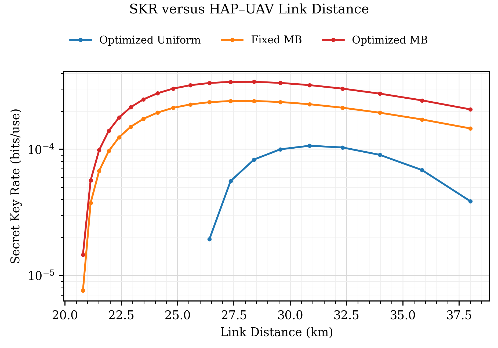
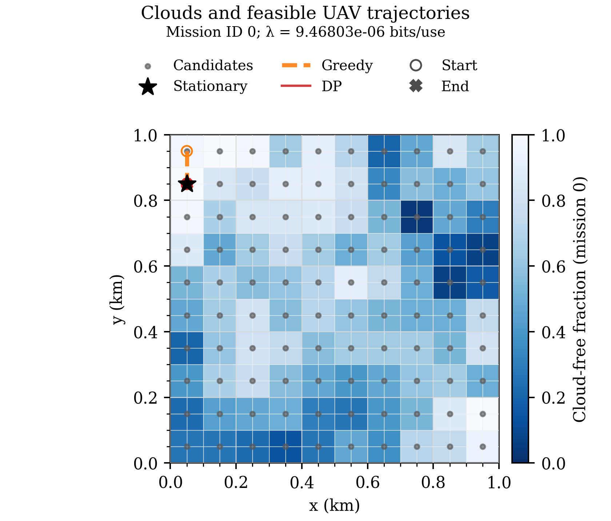
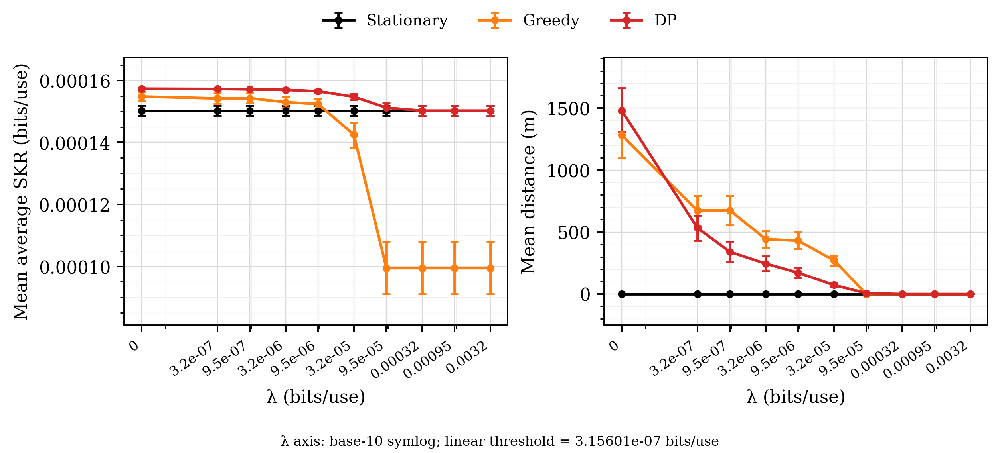

# P1–P2–P3 và Greedy: so sánh số HAP–UAV theo bản thảo

**UNVALIDATED_SECURITY_MODEL — NOT_READY_FOR_PUBLICATION_SCALE_RUNS**. MI 2D/Holevo homodyne là quy ước so sánh số theo yêu cầu; chưa phải chứng minh an toàn homodyne.

## Mô hình và nguồn

HAP (11419.65511459133,450,20000) m; UAV cao1000m,100 tâm ô50–950m. 30slot×20s, vmax15m/s, Dref1000m, khởi đầu tự chọn, không chi phí triển khai/đường về. Hình học và mây là giả định tổng hợp được người dùng chọn; bản thảo chưa cho số cụ thể.

Quang học1550nm, phân kỳ toàn phần233µrad, đường kính thu.08m, tauzen.92, jitter15.61µrad, sigma_h1m, boresight0, AoA1.5mrad, FOV nửa góc6.25mrad, HV/gió21m/s/Cn2ground1e-14. HV/Gd dùng cùng closure repository đã công khai trong lần recheck. beta.95, xi_ch.0186, R1/xi_det0.

eta_f=<sqrt(eta)>²; N=(<eta>−eta_f)VA+.0186<eta>; xi_f=N/eta_f. MI chuẩn hóa2D, trung bình2sqrt(eta_f)alpha, phương sai từng trục1+N, không chia2; Holevo giữ nu3=sqrt[V(V−Z²/W)]. VA=2<n>. PDF[0,1] giữ nguyên tử outage, không chuẩn hóa lại.

233 nguồn exact(197MB+36Uniform), không tính C,w/AP/AO mới. P1 có100 vị trí,60 hình học chính xác,13980 lượt SKR và23300 hàng vị trí–nguồn. RawK tốt nhất theo vị trí từ0.000116296277449 đến0.000157800444621 bits/use. Số vị trí dương theo họ: {'MB': 100, 'Uniform': 0}.

P1 tối đa raw trước khi lấy phần dương. Hòa theo ν,VA,ensemble hash tăng dần. N và xi_f tính lại theo VA từng nguồn; chỉ moment kênh được chia sẻ theo danh tính hình học chính xác. Catalog MBnu.05–.8/VA.025–8, UniformVA.02–12; biên catalog không phải tối ưu liên tục.

## Mây và thông tin

Dùng lại đúng100 ma trận mây scenario0 đã xác thực: PCG64 SeedSequence([20261015,id]), p.4, ell250m, AR1rho.9; replayID0,1,99. Covariance Gaussian exp(−d/ell); c=1[z<Phi^-1(p)]. Thời gian tương quan tiềm ẩn khoảng190s; hệ số Bernoulli được tính từ tích phân ngưỡng. S=(1−c)Kstar, chặn hoàn toàn bằng0; không tính kênh lượng tử lần nữa khi chặn.

P2 và DP biết toàn bộ cloud horizon, là benchmark offline. Greedy chỉ nhận slot hiện tại. Nguồn được tối ưu một lần mỗi vị trí, dùng lại ở các slot thông thoáng; không tối ưu nguồn theo slot.

## P2, Greedy và DP

U=mean(S_path)−lambda*D/Dref. DP hiện có lưu F/Nt; đã đối chiếu recursion tích lũy F1=S1 và penalty Nt*lambda với đánh giá trực tiếp. Greedy dùng cùng Nt*lambda, speed và free-start. Không ép các chiến lược chọn cùng điểm đầu. Availability=mean(S>0), không dùng ngưỡng demo0.001.

lambda_hi=2*Kmax*Dref/dmin=0.00315600889242 bits/use; dmin=100.0m. Dải hệ số [0, 0.0001, 0.0003, 0.001, 0.003, 0.01, 0.03, 0.1, 0.3, 1]; hình quỹ đạo dùng lambda=9.46802667725e-06, nhiệm vụID0, chốt trước khi xem đường đi.

| Phương án | SKR trung bình | Khoảng cách (m) | U | Slot dương | Điểm đầu→cuối (index0) |
|---|---:|---:|---:|---:|---|
|Stationary|0.00015762814456|0|0.00015762814456|30|80→80|
|Greedy|0.000157725781261|100|0.000156778978594|30|90→80|
|DP|0.00015762814456|0|0.00015762814456|30|80→80|

Đây là nhiệm vụ minh họa đã chọn trước. Thống kê chính dùng100 nhiệm vụ độc lập và CI95% t-Student; chênh lệch so sánh theo cặp cùng seed/ID. Phần trăm chỉ có khi mẫu số dương.

| Phương án | Mean SKR [CI95%] tại λ minh họa | Mean distance [CI95%] (m) | Mean U [CI95%] |
|---|---:|---:|---:|
|Stationary|0.000150242819 [0.000148619113, 0.000151866525]|0 [0, 0]|0.000150242819 [0.000148619113, 0.000151866525]|
|Greedy|0.000152387912 [0.000150652351, 0.000154123473]|430.610183 [363.466266, 497.754101]|0.000148310883 [0.000146225856, 0.00015039591]|
|DP|0.000156495353 [0.000156108273, 0.000156882432]|172.43299 [129.711808, 215.154172]|0.000154862753 [0.000154182553, 0.000155542952]|

DP tối đa U, không nhất thiết tối đa SKR trung bình khi lambda>0. Giá trị dương/nâng cao thống kê không suy ra bảo mật hoặc hiệu quả năng lượng đẩy.

## Kiểm chứng và truy vết

Reference30deg được kiểm tra trước P1; GH16/32/64 trên mọi ứng viên P1: max delta5.82867e-16 bit. Min eig(Gamma+iOmega)=5.34427e-06; phổ symplectic sai khác tối đa2.30926e-14. Đối chiếu PDF bằng tích phân trực tiếp, MI bằng hỗn hợp256 đầy đủ và entropy80/110digit ở ba vị trí đại diện.

1000 đối chiếu Bellman độc lập, sai khác lớn nhất1.0842e-19. Vét cạn nhỏ, v0, N1, lambda0/cao, P1 toàn âm, mây toàn chặn/thông, Greedy causal và kiểm tra provenance nằm trong tests/receipts.

Figure1 dùng6758 hàng đã xác thực và thêm465 lượt cho15 nguồn MB sẵn có; xếp hạng lại toàn catalog ở31 khoảng cách. Đây là biểu diễn khoảng cách của cùng hình học h20/1km, không lấy đường SKR từ cấu hình.55m/10µrad cũ. Vùng dương chỉ báo theo các điểm và khoảng đổi dấu đã đo.

## Giới hạn và bảo toàn

Finite-catalog best-tested và finite-grid offline optimum cho ma trận mây đã cho; không có tối ưu liên tục/toàn miền hoặc matched-energy shaping claim. Chưa có propagation/transit time overhead, calibration propulsion, channel-use rate hay finite-size/composable key proof. Không suy ra tổng bits hoặc bits/J từ bits/use.

Chênh lệch hash frozen lịch sử vẫn giữ nguyên; không chỉnh frozen, mô hình production, source/security helpers, dữ liệu/cache cũ hoặc ObjectiveC. Không training/test-data/final-test/held-out/ publication evaluation, baseline/threshold certification, external manuscript edit, commit/push.

## Hình và dữ liệu

CSV/NPZ ở p1/,clouds/,mobility/,figures/plot_data; mọi hình có vectorPDF vàPNG350dpi. validation/stage_*.json ràng buộc artifact và producer snapshot; validation/final_verification.json kiểm tra dữ liệu đã lưu mà không chạy lại SKR.

## Vị trí tham chiếu và chi phí thực đo

Vị trí index 44 (j=45), (450,450) m: L=21.9393102292 km, góc=29.999999999974 độ. Dùng góc thực này; không làm tròn về 30 độ. Nguồn chọn: MB, ν=0.125, VA=8.0, C=4.4721292430667585, w=1.1568418954834532e-05, raw K=0.0001395162885709351 bits/use.

P1: 388.563 s cho 13980 lượt mới và kiểm tra đại diện; compare: 20.033 s cho 1000 DP và 1000 Greedy, gồm đối chiếu Bellman độc lập và xuất bảng. Figure 1 bổ sung 465 lượt; tổng 14445 lượt SKR mới ngoài các kiểm tra đại diện. Không có lượt tính C,w mới. Thời gian môi trường cụ thể ở environment.json.

Bảng vị trí đứng yên, tọa độ, nguồn xác thực và slot-count: mobility/p2_positions.csv. Khoảng tin cậy theo cặp: mobility/paired_statistics.csv. Dữ liệu hình, loại điểm semilog và ngưỡng symlog: figures/render_receipt.json. Hướng dẫn kiểm tra lại dữ liệu đã lưu: RUN.md.
