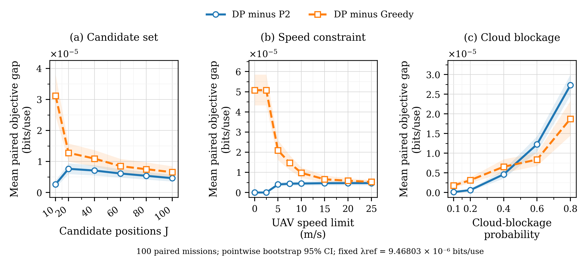

# Stage A — Rà soát hình và bản thảo báo cáo

UNVALIDATED_SECURITY_MODEL; NOT_READY_FOR_PUBLICATION_SCALE_RUNS.

Phần bổ sung từ dữ liệu đã lưu. Giữ nguyên sáu hình, CSV, nguồn P1 và quỹ đạo gốc. Không chạy solver, evaluator vật lý, sinh mây, bootstrap mới hoặc Stage B.

## Kết quả nên dẫn trước

Ở cấu hình mặc định và λref=9.468026677248516×10⁻⁶, DP tăng objective trung bình **3.075% so với P2** và **4.418% so với Greedy**, đồng thời đi ít hơn Greedy **59.96%**. Đây là so sánh offline P2/DP với Greedy chỉ đọc trạng thái hiện tại, chưa cô lập hiệu ứng thông tin tương lai.

| Phương án | K (×10⁻⁴ bit/use) | U (×10⁻⁴ bit/use) | D (m) | Availability (%) |
|---|---:|---:|---:|---:|
| Stationary | 1.502428 | 1.502428 | 0.000 | 97.767 |
| Greedy | 1.523879 | 1.483109 | 430.610 | 98.733 |
| DP | 1.564954 | 1.548628 | 172.433 | 99.900 |

| So sánh tại λref | ΔU (bit/use) | CI95% ghép cặp | Gain U (%) và CI95% | U lớn hơn / hòa / nhỏ hơn (mission) |
|---|---:|---|---|---|
| DP−Stationary | 4.6199339e-06 | [3.5650268e-06, 5.7313908e-06] | 3.075 [2.350, 3.854] | 61 / 39 / 0 |
| DP−Greedy | 6.5518695e-06 | [4.9897767e-06, 8.4622842e-06] | 4.418 [3.325, 5.788] | 89 / 11 / 0 |

CI lấy trực tiếp từ bootstrap 20.000 whole-mission resamples đã lưu, seed 20261020. Đây là CI pointwise trên 100 mission ghép cặp; chưa hiệu chỉnh nhiều so sánh và không phải mức tin cậy bảo mật lượng tử.

## Đánh đổi khi dùng mobility penalty

Với DP mặc định, λ0→λref giảm quãng đường **1482.688→172.433 m (88.37%)**, trong khi SKR giảm **0.515%**. Availability giảm 100→99,9%. Các tỷ lệ này là chênh lệch giữa mean đã lưu; không gán thêm CI cho chênh lệch xuyên λ.

U_DP không thấp hơn hai baseline ở từng mission trong bộ dữ liệu. Riêng K_DP thấp hơn K_Greedy ở **486/2600** cặp cấu hình–mission tại λref (dùng dung sai 10⁻¹²). Vì vậy chỉ được mô tả DP tối ưu **U**, không nói DP luôn có SKR cao hơn trong mọi mission.

## Sáu hình: thông điệp và vị trí trong bản thảo

| Hình | Vai trò | Kết quả và kết luận có thể dùng | Giới hạn cần giữ |
|---|---|---|---|
| [A1](../../existing_data/figures/fig_A1_positions_objective_skr.pdf) | Chính | J10→100: DP K +11.51%, U +11.41%; J20 đạt 96.71% U tại J100. Thêm vị trí giúp mở rộng lựa chọn. | J10 có 8 thành phần liên thông/7 điểm cô lập; từ J20 kết nối. Không cô lập mật độ khỏi kết nối. |
| [A2](../../existing_data/figures/fig_A2_positions_unavailability.pdf) | Chính | Ở λref, J10→100: unavailability DP 7,4→0,1%; P2 9,47→2,23%; Greedy 29,57→1,27%. DP có mean thấp nhất tại các điểm thử. | Availability là S>0; thuật toán không trực tiếp tối ưu chỉ số này. |
| [B](../../existing_data/figures/fig_B_speed_sensitivity.pdf) | Chính | Tốc độ15→25 m/s chỉ tăng U_DP 0.03175%; lợi ích biên nhỏ ở vùng này. | Tại v=0, DP=P2; gap với Greedy do chọn điểm đầu offline, không phải di chuyển. D20→25 m/s giảm 0.679 m. |
| [C](../../existing_data/figures/fig_C_cloud_probability_sensitivity.pdf) | Chính | p0,1→0,8: hiệu năng tuyệt đối giảm nhưng U_DP/P2 gain tăng; tại p0,8 là 25.04% so với P2 và 15.95% so với Greedy. | Chỉ năm mức đã lưu. Không có đỉnh nội miền được chứng minh; không ngoại suy p>0,8. |
| [D](../../existing_data/figures/fig_D_duration_sensitivity.pdf) | Bổ sung | Nt5→30: D_DP 12,48→172,43 m; gain U/P2 0,092→3,075% dù K tuyệt đối giảm nhẹ. | U dùng average reward và total distance; Nt thay đổi cả horizon lẫn mức phạt tương đối, không cô lập lookahead. |
| [E](../../existing_data/figures/fig_E_spatial_correlation_sensitivity.pdf) | Bổ sung | ell50→1000 m: K/A giảm nhưng gain U/P2 tăng 1,46→5,96%; P2 suy giảm mạnh hơn. | ell là tương quan tiềm ẩn, không phải bán kính mây đo được; không có bảo đảm đơn điệu. |

Giữ bốn hình chính **A1, A2, B, C** đúng ưu tiên đã chọn trước batch. D/E cung cấp kiểm tra cơ chế, không bị loại vì kết quả trái kỳ vọng.

## Hình phụ S1: đọc gap thay vì độ chồng đường

[PDF vector](fig_S1_paired_objective_gaps.pdf) · [PNG 350 dpi](fig_S1_paired_objective_gaps.png) · [38 điểm và CI gốc](fig_S1_paired_objective_gaps_data.csv)

S1 giữ ba phép quét J/tốc độ/p và hai đường ΔU=mean(U_DP−U_P2), mean(U_DP−U_Greedy). Không dùng phép trừ hai CI riêng lẻ; band lấy đúng CI của chênh lệch ghép cặp. Không thêm điểm mô phỏng hoặc làm trơn.

Đường DP−Greedy cao tại J nhỏ và tốc độ thấp không tự nó chứng minh mobility gain: Greedy khởi tạo theo slot đầu, còn P2/DP chọn điểm đầu bằng toàn horizon. DP−P2 là đối chiếu phù hợp hơn để mô tả lợi ích đổi vị trí trong cùng điều kiện thông tin offline.

Ở p0,8, ΔU_DP−P2=2.7280557e-05, CI95% [2.4676008e-05, 2.9989589e-05] bit/use. Kết hợp effect size tuyệt đối với tỷ lệ giúp tránh đọc gain lớn chỉ từ mẫu số nhỏ.

## Thuộc tính toán học và phát biểu được phép

| Biến đổi | Bảo đảm | Không được suy ra |
|---|---|---|
| Thêm vị trí lồng nhau | U_DP và U_P2 không giảm | Greedy/availability/quãng đường phải đơn điệu |
| Nới giới hạn tốc độ | U_DP không giảm; P2 không đổi | K hoặc D_DP phải tăng ở λ>0 |
| Tăng p với mask chặn lồng nhau | U_DP và U_P2 không tăng | Availability hoặc mobility gain phải có một dạng cố định |
| Nt hoặc ell thay đổi | Không áp đặt đơn điệu | Xu hướng quan sát là định luật tổng quát |
| So phương án cùng cấu hình | U_DP≥U_Greedy,U_P2 | DP tối ưu availability, năng lượng hoặc SKR riêng lẻ khi λ>0 |

## Tham số ảnh hưởng mạnh nhất

Dùng span=max(mean)−min(mean) trên các dải đã duyệt tại λref, không gọi đây là sensitivity index chuẩn hóa. Với K/availability: **P2 chịu ảnh hưởng lớn nhất bởi p; Greedy bởi tốc độ; DP bởi J**. Với gain U_DP−P2, p tạo span lớn nhất. Với gap DP−Greedy, tốc độ tạo span lớn nhất, có đóng góp của lựa chọn điểm đầu offline.

## Rà soát trình bày và truy vết

Đã xem sáu PNG gốc: chú giải, nhãn, đơn vị, marker/line style, giá trị zero và band CI được giữ. Bố cục không cần sửa; các hình chính có trục bắt đầu quanh zero nên khoảng cách giữa đường có thể nhỏ. S1 bổ sung effect size trực tiếp, không cắt trục các hình gốc.

PDF vector nên dùng khi chèn bản thảo. PNG 350 dpi dùng để xem nhanh; khi phần mềm thu nhỏ preview có thể làm mất nét chữ, cần xem bản gốc trước khi kết luận thiếu nhãn.

[Bản thảo thảo luận tiếng Anh](discussion_en.md) · [English captions gốc](../../figure_captions_en.md) · [Source map](figure_review.csv) · [Metric dẫn xuất](review_metrics.csv) · [Xác minh phần bổ sung](validation_report.md)

Bộ gốc có receipt cố định và verifier đệ quy yêu cầu chính xác danh sách tệp cũ. Phần analysis mới này không sửa receipt/verifier gốc; verify_review.py xác minh trực tiếp toàn bộ thành viên receipt và các hash producer trước khi kiểm tra phần bổ sung. Không dùng lỗi coverage của verifier cũ sau khi thêm thư mục con để suy ra dữ liệu gốc bị thay đổi.

Giữ nguyên chênh lệch frozen hash, Objective C USER_STOPPED và mọi giới hạn finite-catalog/grid, synthetic clouds, MI2D/Holevo homodyne chưa xác thực an toàn, chưa hiệu chuẩn năng lượng. Không thay nguồn khoa học, bảo mật, frozen model, baseline/threshold, lifecycle; không training/test/held-out, external manuscript edit, commit/push.
