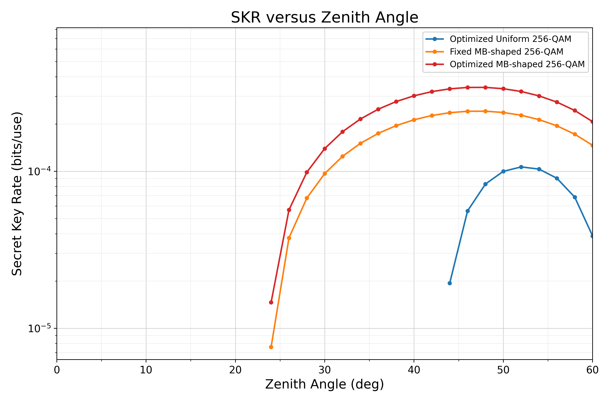
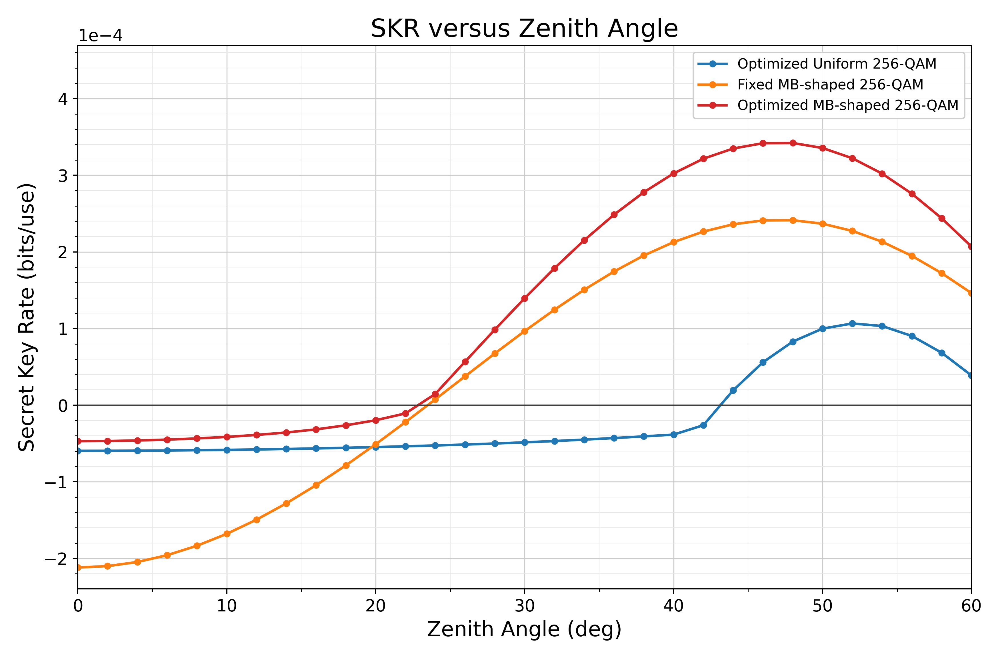

# SKR theo góc thiên đỉnh — so sánh số theo bản thảo

**CURRENTLY_VERIFIED_PASS** cho các kiểm tra số và provenance trong phạm vi này. **UNVALIDATED_SECURITY_MODEL; NOT_READY_FOR_PUBLICATION_SCALE_RUNS** vẫn giữ nguyên.

Dùng MI 2D chuẩn hóa và Holevo homodyne như yêu cầu. Phép ghép này là so sánh số theo quy ước bản thảo, chưa thiết lập tốc độ khóa homodyne an toàn về mặt vật lý. Tối ưu chỉ trên catalog hữu hạn: **BEST_CURRENT_EXACT_TESTED_CANDIDATE_ONLY**.

## Kết quả và xu hướng

Đã đánh giá 31 góc ban đầu (0–60°, bước 2°), thêm 0 góc làm mịn; tổng 31 góc × 218 nguồn = 6758 lượt. Mỗi góc dùng toàn bộ 36 nguồn Uniform và 182 nguồn MB đã xác thực; MB cố định cũng thuộc catalog MB. Không tạo C,w mới, không nội suy, không cắt SKR âm.

| Phương án | K(0°) | K(30°) | K(60°) | K lớn nhất đã đo / góc |
| --- | --- | --- | --- | --- |
| Uniform tối ưu trong catalog | -5.95769431897e-05 | -4.8506709948e-05 | 3.87192470133e-05 | 0.000106625951727 / 52° |
| MB cố định | -0.00021183157343 | 9.66579973751e-05 | 0.000146215877078 | 0.000241357175677 / 48° |
| MB tối ưu trong catalog | -4.69932502045e-05 | 0.000139516288571 | 0.000206972973106 | 0.0003421451103 / 48° |

- Uniform tối ưu trong catalog: không đơn điệu; các bước giảm là 52→54°, 54→56°, 56→58°, 58→60°.
- MB cố định: không đơn điệu; các bước giảm là 48→50°, 50→52°, 52→54°, 54→56°, 56→58°, 58→60°.
- MB tối ưu trong catalog: không đơn điệu; các bước giảm là 48→50°, 50→52°, 52→54°, 54→56°, 56→58°, 58→60°.

Các góc Uniform dương: [44, 46, 48, 50, 52, 54, 56, 58, 60]

## Miền dương và giới hạn vận hành đã khảo sát

| Phương án | Góc dương lớn nhất đã đo | Góc không dương đầu tiên | Khoảng chuyển dương→không dương | Khoảng L (km) |
| --- | --- | --- | --- | --- |
| Uniform tối ưu trong catalog | 60° | 0° | Chưa quan sát | Không áp dụng |
| MB cố định | 60° | 0° | Chưa quan sát | Không áp dụng |
| MB tối ưu trong catalog | 60° | 0° | Chưa quan sát | Không áp dụng |

- Uniform tối ưu trong catalog: các điểm dương từ 44° đến 60° (L=26.4131082293–38 km).
  Chuyển không dương→dương nằm giữa hai điểm đã tính [42, 44]° (L=25.5670218625–26.4131082293 km); không suy ra nghiệm nội suy.
  Uniform tối ưu trong catalog còn dương ở 60° (38 km): 60° là biên khảo sát, chưa phải giới hạn vật lý cực đại.
- MB cố định: các điểm dương từ 24° đến 60° (L=20.7980892916–38 km).
  Chuyển không dương→dương nằm giữa hai điểm đã tính [22, 24]° (L=20.4921601109–20.7980892916 km); không suy ra nghiệm nội suy.
  MB cố định còn dương ở 60° (38 km): 60° là biên khảo sát, chưa phải giới hạn vật lý cực đại.
- MB tối ưu trong catalog: các điểm dương từ 24° đến 60° (L=20.7980892916–38 km).
  Chuyển không dương→dương nằm giữa hai điểm đã tính [22, 24]° (L=20.4921601109–20.7980892916 km); không suy ra nghiệm nội suy.
  MB tối ưu trong catalog còn dương ở 60° (38 km): 60° là biên khảo sát, chưa phải giới hạn vật lý cực đại.

“Góc không dương đầu tiên” tính từ 0°, nên có thể là 0° khi đường MB bắt đầu âm rồi mới dương. Chỉ khoảng dương→không dương mới chặn giới hạn phía góc lớn. Không quan sát khoảng như vậy thì không tạo khoảng chặn giả. Các điểm hữu hạn không chứng minh tính dương liên tục giữa các điểm.

## Mức cải thiện MB

| Góc | K MB cố định | K MB tối ưu | ΔK | Cải thiện khi MB cố định dương |
| --- | --- | --- | --- | --- |
| 0° | -0.00021183157343 | -4.69932502045e-05 | 0.000164838323226 | Không dùng % vì mẫu số không dương |
| 30° | 9.66579973751e-05 | 0.000139516288571 | 4.28582911962e-05 | 44.3401% |
| 60° | 0.000146215877078 | 0.000206972973106 | 6.07570960281e-05 | 41.553% |

ΔK lớn nhất đã đánh giá = 0.000164838323226 bits/use tại 0°. Cột phần trăm trong CSV chỉ có giá trị khi K MB cố định > 0.

## Thay đổi tham số nguồn

Đây là góc đầu tiên có lựa chọn mới trên lưới đã đo; vị trí chuyển chính xác chỉ được giới hạn bởi điểm liền trước, không phải nghiệm chuyển liên tục.

| Phương án | Điểm trước (°) | Điểm đầu tham số mới (°) | Tham số trước | Tham số mới |
| --- | --- | --- | --- | --- |
| Optimized Uniform | 24 | 26 | {"Uniform_optimal_VA": 0.02} | {"Uniform_optimal_VA": 0.025} |
| Optimized Uniform | 26 | 28 | {"Uniform_optimal_VA": 0.025} | {"Uniform_optimal_VA": 0.04} |
| Optimized Uniform | 28 | 30 | {"Uniform_optimal_VA": 0.04} | {"Uniform_optimal_VA": 0.0475} |
| Optimized Uniform | 30 | 32 | {"Uniform_optimal_VA": 0.0475} | {"Uniform_optimal_VA": 0.06} |
| Optimized Uniform | 32 | 34 | {"Uniform_optimal_VA": 0.06} | {"Uniform_optimal_VA": 0.075} |
| Optimized Uniform | 34 | 36 | {"Uniform_optimal_VA": 0.075} | {"Uniform_optimal_VA": 0.1} |
| Optimized Uniform | 36 | 38 | {"Uniform_optimal_VA": 0.1} | {"Uniform_optimal_VA": 0.11} |
| Optimized Uniform | 38 | 40 | {"Uniform_optimal_VA": 0.11} | {"Uniform_optimal_VA": 0.13} |
| Optimized Uniform | 40 | 42 | {"Uniform_optimal_VA": 0.13} | {"Uniform_optimal_VA": 12.0} |
| Optimized MB | 10 | 12 | {"MB_optimal_nu_raw": 0.3, "MB_optimal_VA": 0.5194444399281013} | {"MB_optimal_nu_raw": 0.25, "MB_optimal_VA": 0.6083331799901215} |
| Optimized MB | 12 | 14 | {"MB_optimal_nu_raw": 0.25, "MB_optimal_VA": 0.6083331799901215} | {"MB_optimal_nu_raw": 0.2, "MB_optimal_VA": 0.7416615151490328} |
| Optimized MB | 16 | 18 | {"MB_optimal_nu_raw": 0.2, "MB_optimal_VA": 0.7416615151490328} | {"MB_optimal_nu_raw": 0.3, "MB_optimal_VA": 0.9388888798562025} |
| Optimized MB | 18 | 20 | {"MB_optimal_nu_raw": 0.3, "MB_optimal_VA": 0.9388888798562025} | {"MB_optimal_nu_raw": 0.3, "MB_optimal_VA": 1.358333319784304} |
| Optimized MB | 20 | 22 | {"MB_optimal_nu_raw": 0.3, "MB_optimal_VA": 1.358333319784304} | {"MB_optimal_nu_raw": 0.25, "MB_optimal_VA": 1.6249995399703647} |
| Optimized MB | 22 | 24 | {"MB_optimal_nu_raw": 0.25, "MB_optimal_VA": 1.6249995399703647} | {"MB_optimal_nu_raw": 0.125, "MB_optimal_VA": 8.0} |

Xem `source_parameter_changes.csv`. Nguồn cố định luôn có νraw=0.165, VA=5.475. Miền catalog Uniform VA=0.02–12; MB νraw=0.05–0.8, VA=0.025–8. Giá trị nằm ở biên catalog vẫn chỉ là ứng viên tốt nhất đã thử.

## Kiểm tra tại 30°

L=21.939310229205777 km; <η>=0.0002640339370277642854, <√η>=0.0156059440205538217562, ηf=0.0002435454887726595830. Tất cả trường kênh khớp hàm recheck bất biến ở sai số dưới 1e-60 tương đối có thang tối thiểu 1.

MB cố định K=9.66579973751e-05; Uniform VA=0.0475, K=-4.8506709948e-05 bits/use. Hai tham chiếu cũ được tái lập trước khi quét. Uniform được xếp hạng lại trên toàn bộ 36 nguồn, không mặc định dùng ứng viên cũ. Sai số chi tiết nằm trong `reference_gate.json`.

## Phương trình và truy vết

- Kênh: `run_sweep.py:channel_at_angle`, bản sao các phương trình của `scripts/recheck_manuscript_homodyne_noise.py:channel` với ζ thay đổi. Tính lại L=19secζ km, ηatm=.92^secζ, tích phân HV, σR², Gd, wL, weff, weq, σs²=1+(L·15.61e-6)², A0 và mọi hệ số/moment PDF ở từng góc. Khép kín HV/Gd là quy ước repository đã công khai ở recheck, không phải công thức được định nghĩa đầy đủ trong PDF.
- PDF: công thức đóng Q cho q=0,1/2,1 trên [0,1], cộng riêng nguyên tử outage P0; không chuẩn hóa lại. Đối chiếu tích phân trực tiếp ở 0°,30°,60° lưu trong `channel_closed_vs_quadrature.csv`.
- N=(<η>−<√η>²)VA+.0186<η>; ηf=<√η>²; ξf=N/ηf. Không thêm nhiễu tổn hao thuần hoặc detector; ideal R=1, ξdet=0.
- MI: nhập nguyên trạng `uniform_mi_2d` từ script Uniform đã kiểm chứng. Hỗn hợp Cartesian của cả Uniform và MB phân tích tích chính xác; vẫn cộng tensor 2D hai trục, trung bình 2√ηf α, phương sai từng trục 1+N. Không chia 2, không thêm nhiễu heterodyne. Đối chiếu hỗn hợp đầy đủ 256 ký hiệu bằng kernel gốc tại 0°,30°,60°.
- Holevo: nhập nguyên trạng `security` của recheck; V=VA+1, W=1+ηfVA+N, Z=2<√η>C−√(2Nw), ν3=√[V(V−Z²/W)]. Entropy dùng 80 chữ số; kiểm tra 110 chữ số ở ba góc đại diện.
- Nguồn: xác thực schema, cache key, ba hash triển khai, support256, binary64 ν/VA, hash đầy đủ tệp, hash ensemble, PMF MB, hình học và VA=2<n>. Không chạy lại AP, thay đổi support hoặc ladder1050/1250/1450. `source_roster.csv`, `verified_ensembles.npz` và `input_manifest.json` ràng buộc đầu vào.

## Xác thực số và giới hạn

7445 kiểm tra trong producer đạt PASS; 9 kiểm tra tự thân độc lập đạt PASS. Mọi ứng viên ở mọi góc đều được GH16/32/64: max|ΔMI|=6.06286e-16 bit. Max sai khác phổ symplectic đối chiếu ma trận=2.84217e-14; min eigenvalue(Γ+iΩ)=2.15031e-06>0. Không sửa covariance, ν, SKR hoặc dữ liệu nguồn để ép dấu dương.

Đặc tả frozen hiện tại có SHA256 df83ea63af3b475ecca03a44d22d3240ab24d695ff0ebef31f0cd6747db78c15, khác hash lịch sử mong đợi 561fecc97cdf9967034ffd6865c1605804b624b98f47a091e47f17e520a2a7b1. Tệp được giữ nguyên; đây vẫn là blocker cho nâng trạng thái production. Không thay mô hình production, hàm bảo mật, nguồn/cache cũ, cấu hình hoặc frozen spec; không training, test-data/final-test/held-out/publication evaluation, chứng nhận baseline/threshold, khởi động ObjectiveC, commit hay push.

## Tệp và tái lập

- `skr_vs_zenith_angle.csv`: bảng so sánh đầy đủ; `initial_31_points.csv`: 31 điểm ban đầu.
- `skr_vs_zenith_angle_detailed.csv`: MI, βMI, Holevo, noise, nguồn và covariance cho cả ba phương án.
- `all_candidate_evaluations.csv`: toàn bộ ứng viên tại mọi góc, bao gồm GH16/32/64 và kiểm tra ma trận.
- `channel_by_angle.json`, `selected_high_precision_models.json`: mọi trường kênh và số học chính xác cao.
- `operational_zenith_angles.csv`, `source_parameter_changes.csv`: miền dương và lựa chọn nguồn.
- `verify_results.py` chỉ đọc bằng chứng/hash đã lưu; receipt ràng buộc các tệp đầu ra và kiểm tra 4.807 tệp cũ, chỉ cho phép năm tài liệu ledger thay đổi.
- Chạy lại khoa học chỉ trong namespace mới có startup manifest phù hợp; producer từ chối ghi đè summary đã hoàn tất. Interpreter: `.venv/Scripts/python.exe -X utf8 -B`. Không cần cài thêm phụ thuộc.

## Hình so sánh và bảng vận hành

PNG 350 dpi; PDF vector. Các giá trị không dương được giữ nguyên trong CSV/hình tuyến tính; hình log dùng NaN để ngắt đoạn, không thay bằng epsilon hoặc nối qua đoạn âm. `render_figures.py` chỉ đọc CSV để xuất bố cục cuối, dành khoảng trống cho legend góc phải trên; không tính lại số liệu. `render_receipt.json` ràng buộc CSV/renderer.

| Phương án | Dương lớn nhất đã đo (°) | Không dương đầu tiên (°) | Trạng thái |
| --- | --- | --- | --- |
| Uniform tối ưu trong catalog | 60 | 0 | POSITIVE_THROUGH_SWEEP_BOUNDARY_NOT_TRUE_MAXIMUM |
| MB cố định | 60 | 0 | POSITIVE_THROUGH_SWEEP_BOUNDARY_NOT_TRUE_MAXIMUM |
| MB tối ưu trong catalog | 60 | 0 | POSITIVE_THROUGH_SWEEP_BOUNDARY_NOT_TRUE_MAXIMUM |
